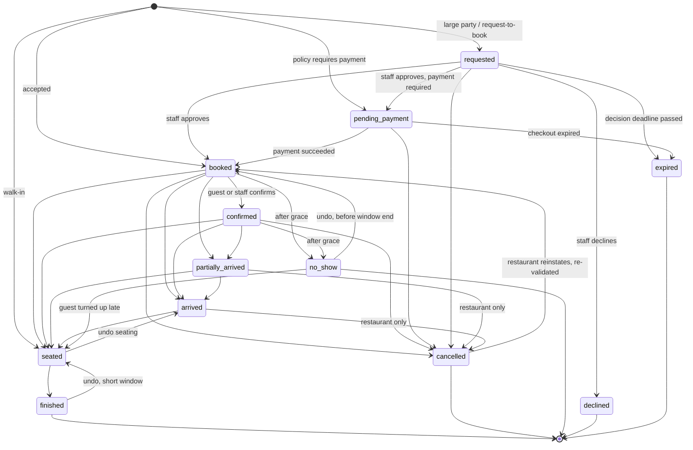

# Restaurant reservations: engineering complexities and recommendations for Menuza

Status: research note. Scope: an OpenTable / Resy / SevenRooms class reservation
system built into Menuza behind an org-level feature flag, with customer PII
kept in the regional per-organization SQLite database (`packages/tenant-db`)
behind `apps/tenant-api`.

Method: web search (search-result summaries only; no page fetches) of vendor
documentation (OpenTable, Resy, SevenRooms support articles), operations
research literature on table management and restaurant revenue management,
payment and platform documentation (Stripe, Cloudflare Durable Objects, TC39
Temporal), engineering blogs (Yelp wait-time predictions), and messaging
compliance sources, combined with prior knowledge. Where a figure depends on
third-party behavior that changes over time (card authorization validity,
regulatory windows), it is marked "verify before relying on it".

A short read-only look at the repository was used to align the recommendations
with existing conventions:

- `packages/tenant-db/src/schema.ts` uses `*_at` epoch milliseconds (UTC),
  `*_date` as `YYYY-MM-DD` in the local time zone, and minutes as integers for
  the staff tables. The reservation tables below follow the same convention.
- `apps/tenant-api/src/services/order-service.ts` already implements
  slot-capacity holds for online orders (`expireHolds`, `assertSlotCapacity`),
  wrapped as
  `runExclusive(orgId, () => retryOnSqliteBusy(() => db.transaction(...)))`.
  That is the precedent to follow for reservation writes.
- `apps/tenant-api/src/lib/concurrency.ts` (`runExclusive`) serializes writes
  per org inside one process; `apps/tenant-api/workers/tenant-org.ts` notes that
  the Durable Object "yields at every await", so several requests can be in
  flight in one object at once.
- `notification_outbox` (dedupe key unique index, `status` + `next_attempt_at`
  index) is the existing outbox pattern.
- Name collisions to avoid: `shifts` (staff scheduling) and
  `restaurant_order_reservations` (order inventory holds) already exist. Use a
  `rsv_` table prefix and call reservation time windows **services** (Lunch,
  Dinner) rather than "shifts".

---

## 0. Summary of recommendations

| Topic                  | Recommendation                                                                                                                                                                                                                                                                                                                                                                        |
| ---------------------- | ------------------------------------------------------------------------------------------------------------------------------------------------------------------------------------------------------------------------------------------------------------------------------------------------------------------------------------------------------------------------------------- |
| Inventory model        | Hybrid: concrete tables + turn times are the source of truth for "does it fit"; pacing (covers/parties per interval), concurrent-cover caps and an online allocation are overlays that can only remove availability. "Simple mode" (no floor plan) is the same engine with one virtual pool.                                                                                          |
| Availability algorithm | Per business date: resolve effective services, generate local wall-clock start times on the interval grid, filter by horizon, lead time, cutoffs, booking windows, then pacing, then table fit (direct fit first, bounded repair second). Load a whole business day in one query and cache it in memory keyed by `(location, business_date, day_version)`.                            |
| Table assignment       | Every system-accepted booking holds a tentative concrete table or combination at all times. Greedy weighted best fit at write time, a bounded augmenting-path repair when no direct fit exists, and an optional background re-optimization outside a freeze window. Locked and in-service assignments are never moved. Exact optimization is NP-hard in general; do not depend on it. |
| Concurrency            | All capacity-changing writes go through one function per org: per-org in-process mutex (`runExclusive`) + one SQLite write transaction that sweeps expired holds, re-validates, and writes. No network I/O inside the critical section. A row-level `version` column for host edits, idempotency keys for creates, and an overlap trigger as a safety net.                            |
| Holds                  | Created when the guest picks a time (before OTP), 7 minutes by default, extended for payment, counted exactly like bookings, keyed by a random hold token, rate limited, at most one active hold per token.                                                                                                                                                                           |
| Time                   | Rules are local wall-clock (minutes from business-day start, may exceed 1440). Reservations store `business_date` + `local_start_min` + `time_zone` as the intent and `start_at`/`end_at` epoch ms as derived instants. Durations are elapsed time. Skip nonexistent local times; show ambiguous local times once (earlier offset).                                                   |
| State machine          | `requested`/`pending_payment` → `booked` → `confirmed` → `partially_arrived`/`arrived` → `seated` (with optional course sub-status) → `finished`; terminal `cancelled` (by guest/restaurant/system), `no_show`, `declined`, `expired`. "Late" is derived, not a state. Capacity is consumed from booked through seated, released at finished, cancelled, or no-show.                  |
| Payments               | Card guarantee via saved payment method (Stripe SetupIntent or equivalent) and an off-session charge on no-show, not an authorization hold. Deposits/prepayments via hosted checkout. Snapshot the policy on the reservation. Treat off-session failure as normal.                                                                                                                    |

---

## 1. Inventory and availability models

### 1.1 The three families

**Slot / pacing based (covers per interval).** The restaurant says "at most N
covers (or M parties) may start in each 15-minute interval" and possibly "at
most K covers seated at once". There is no floor plan. This is how many smaller
restaurants start (Resy "Slots", OpenTable "flow controls"/pacing).

- Pros: trivial to configure; fast; tolerant of hosts who seat by eye.
- Cons: can sell combinations of party sizes that do not physically fit (six
  2-tops sold as twelve covers does not seat a party of 12; twelve covers in a
  room of 4-tops can be sold as twelve 1-person parties occupying twelve
  tables). Overbooking is "structural", and the restaurant compensates with
  conservative numbers, leaving revenue on the table.

**Table based (concrete tables + turn times).** Each table has min/max covers,
an area, and online-bookable flags; combinations are explicit sets of tables
with their own min/max. Each party occupies a table (or combination) for a turn
time that depends on party size and service. A start time is available when some
table or combination fits the party and is free for the whole turn.

- Pros: physically correct; supports seating area preferences; enables wait
  quoting and live table status; finds "squeeze-ins".
- Cons: needs a configured floor plan; feasibility is a scheduling problem (see
  Section 3); depends on accurate turn times (OpenTable's documentation stresses
  that turn times drive availability, pacing and wait quotes; too short
  overbooks and rushes service, too long under-books).

**Hybrid (industry default for full-service).** Table feasibility plus pacing
overlays (kitchen and front-of-house can only absorb so many arrivals at once,
regardless of free tables), plus online inventory release rules ("access rules"
in SevenRooms and OpenTable: which tables/areas/times/party sizes are offered to
which channel). OpenTable, SevenRooms, and Resy's full-stack tiers all work this
way.

### 1.2 Recommendation

Implement the hybrid model as one engine:

1. **Table fit is the hard constraint.** A system-accepted booking must have a
   feasible concrete assignment.
2. **Overlays only remove availability**, never add it:
   - pacing per interval: max covers and/or max parties starting in a bucket;
   - optional rolling pacing: max covers starting in any rolling window (for
     example 30 minutes, protects the kitchen);
   - optional concurrent covers cap (fire-code or service cap);
   - online allocation: which tables/areas are online-bookable per service, an
     online cap per interval or per service, max online party size;
   - booking windows: online booking only between some local times of a service
     (for example "online 17:30-20:30, phone only after").
3. **Simple mode** (no floor plan): synthesize one virtual "pool" whose
   constraint is the concurrent-covers cap plus pacing. Same code path, so a
   restaurant can graduate to a floor plan without migrating data (existing
   bookings simply become unassigned and get auto-assigned once tables exist).

Why: correctness (never sells what cannot be seated) is the property guests and
hosts notice most; pacing is what kitchens need; the online allocation is what
operators use to protect walk-ins, regulars and phone bookings.

### 1.3 Inputs to availability

| Input                          | Notes                                                                                                                                                             |
| ------------------------------ | ----------------------------------------------------------------------------------------------------------------------------------------------------------------- |
| Services for the business date | Resolved from weekly templates + date overrides (Section 6). Each has first seating, last seating, hard end, interval (15 min typical), and settings.             |
| Booking interval               | Grid for start times; 15 minutes is typical, 30 minutes common for small venues.                                                                                  |
| Turn time by party size        | Table: party 1-2 → 75 min, 3-4 → 90, 5-6 → 120, 7+ → 150, per service; optional per-area or per-day-of-week override. Optional buffer (cleaning/reset) per table. |
| Tables                         | Area, min covers, max covers, online-bookable, combinable, priority, active.                                                                                      |
| Combinations                   | Explicit sets of 2+ tables (never compute arbitrary adjacency at runtime), own min/max covers, online-bookable flag, priority.                                    |
| Existing occupancy             | Active reservations (booked through seated) with their table assignments and windows; live holds; table blocks; seated parties running long (predicted end).      |
| Blocks                         | Table or area blocked for a window (private event, broken table, staff decision).                                                                                 |
| Pacing limits                  | Per service, optionally per time period within the service, per channel.                                                                                          |
| Same-day cutoff                | "Online booking for today closes at 15:00" or "service closes for online booking N minutes before first seating".                                                 |
| Minimum lead time              | Instant-based, for example 60 minutes before start.                                                                                                               |
| Booking horizon                | "Up to 30 days ahead, the next day opens at 10:00 local" (a release time creates the Resy-style "drop").                                                          |
| Online release                 | Which tables/areas, how many covers per interval, max party size, which services online.                                                                          |

### 1.4 Availability algorithm

Terminology: `local_min` = minutes from the start of the **business date**
(00:00 of that calendar date), so a 01:00 seating after midnight on the 14th's
business date is `local_min = 1500`. `unit` = a single table or a combination.

```text
function searchAvailability(req, now):
  # req: { locationId, businessDate, partySize, areaId?, channel }
  # channel in { online, voice_agent, phone, host }
  cfg = loadLocationConfig(req.locationId)            # cached; includes time zone
  if not cfg.enabled: return []
  if req.partySize < 1: return error
  if req.channel is guest-facing and req.partySize > cfg.maxOnlineParty:
      return { largeParty: true, contact: cfg.largePartyContact, slots: [] }

  tz = cfg.timeZone
  if not withinHorizon(req.businessDate, now, tz, cfg): return []
  services = resolveServices(req.locationId, req.businessDate)   # Section 6
  day = loadDayState(req.locationId, req.businessDate, now)
  # day: tables, combos, blocks, active reservations + assignments,
  #      holds with expires_at > now, predicted ends of seated parties,
  #      pacing counters, version. Also loads the previous business date's
  #      reservations whose end_at > start of this business date (overlap).

  out = []
  seenInstants = set()
  for svc in services:
    if not svc.isOpenTo(req.channel): continue
    turnMs = turnMinutes(svc, req.partySize) * 60_000
    for m in range(svc.firstSeatingMin, svc.lastSeatingMin + 1, svc.intervalMin):
      startAt = localToInstant(req.businessDate, m, tz)     # null for DST gap
      if startAt is null or startAt in seenInstants: continue  # gap / dup hour
      if not svc.bookingWindowFor(req.channel).contains(m): continue
      if startAt - now < cfg.minLeadMs(req.channel): continue
      if sameDayCutoffPassed(req.businessDate, svc, now, tz, cfg, req.channel): continue
      endAt = startAt + turnMs
      if endAt > svc.hardEndAt and not svc.allowOverrunPastClose: continue
      if not pacingOk(day, svc, m, req.partySize, req.channel): continue
      if not concurrentCoversOk(day, svc, startAt, endAt, req.partySize): continue
      fit = findTableFit(day, svc, req, startAt, endAt, mode = SEARCH)
      if fit is null: continue
      seenInstants.add(startAt)
      out.append({ startAt, localTime: m, serviceId: svc.id,
                   areaIds: fit.feasibleAreas, needsRequest: fit.requiresApproval })
  return out

function pacingOk(day, svc, m, p, channel):
  if channel == host: return true                     # host sees a warning instead
  bucket = floorToInterval(m, svc.pacingBucketMin)
  c = day.coversStartingIn(svc, bucket)               # bookings + holds, not cancelled
  k = day.partiesStartingIn(svc, bucket)
  lim = svc.pacingFor(bucket)                         # time-period override or default
  if lim.maxCovers  != null and c + p > lim.maxCovers:  return false
  if lim.maxParties != null and k + 1 > lim.maxParties: return false
  if svc.rolling != null:
    for each window w of length svc.rolling.minutes that contains m:
      if day.coversStartingIn(w) + p > svc.rolling.maxCovers: return false
  if channel is guest-facing and svc.onlineCapPerBucket != null:
    if day.onlineCoversStartingIn(svc, bucket) + p > svc.onlineCapPerBucket: return false
  return true

function findTableFit(day, svc, req, startAt, endAt, mode):
  occEnd = endAt + svc.resetBufferMs
  units = day.units.filter(u =>
      u.active and u.minCovers <= req.partySize <= u.maxCovers and
      svc.areaAllowed(u.areaId, req.channel) and
      (req.areaId is null or u.areaId == req.areaId) and
      (req.channel == host or u.onlineBookable))
  direct = units.filter(u => all t in u.tables: day.isFree(t, startAt, occEnd))
  if direct not empty:
      return { unit: best(direct, scoreContext), feasibleAreas: areasOf(direct) }
  budget = (mode == SEARCH) ? SEARCH_REPAIR_BUDGET : BOOK_REPAIR_BUDGET
  for u in sortByScore(units):
      plan = tryRepair(day, u, startAt, occEnd, depth = 2, budget)
      if plan: return { unit: u, moves: plan, feasibleAreas: [u.areaId] }
  return null
```

`day.isFree(t, s, e)` checks that no occupancy interval on table `t`
(assignments of active reservations, live holds, blocks, predicted overrun of a
seated party) intersects `[s, e)`. Use half-open intervals everywhere so a
booking ending at 19:30 and one starting at 19:30 do not conflict.

Horizon and cutoff helpers:

```text
function withinHorizon(businessDate, now, tz, cfg):
  today = currentBusinessDate(now, tz, cfg.dayStartMin)
  if businessDate < today: return false
  lastOpen = today + cfg.horizonDays
  if cfg.releaseLocalMin != null and localMinutesNow(now, tz) < cfg.releaseLocalMin:
      lastOpen = lastOpen - 1 day        # tomorrow's "drop" has not happened yet
  return businessDate <= lastOpen

function sameDayCutoffPassed(businessDate, svc, now, tz, cfg, channel):
  if channel == host: return false
  if businessDate != currentBusinessDate(now, tz, cfg.dayStartMin): return false
  if cfg.sameDayCutoffLocalMin != null and localMinutesNow(now, tz) >= cfg.sameDayCutoffLocalMin:
      return true
  if svc.closeOnlineMinutesBeforeFirstSeating != null:
      return now >= localToInstant(businessDate, svc.firstSeatingMin, tz)
                    - svc.closeOnlineMinutesBeforeFirstSeating * 60_000
  return false
```

### 1.5 Calendar (multi-day) search

The public widget usually shows "which dates have anything for party size P"
across the horizon (30-90 days). Compute a per-date summary
`{ businessDate, partySize → hasAvailability, firstSlot, lastSlot }` lazily,
cache it under `(location, business_date, day_version)`, and invalidate on any
write to that business date. With per-day state already cached, a 60-day scan is
60 cache lookups plus a few cold computations.

### 1.6 Performance for SQLite and public search

Data volumes are small per location (≤ 150 tables, ≤ 100 combinations, ≤ 1000
reservations per business day even for a very busy venue). The cost drivers are
query count and repeated recomputation, not algorithmic complexity.

- **One query per business day**: `rsv_reservations` by
  `(location_id, business_date)` joined with `rsv_reservation_tables`, plus
  holds and blocks overlapping the day, plus the previous business date's
  reservations whose `end_at` reaches into this one. Index:
  `(location_id, business_date, status)`.
- **Occupancy structure**: per table a sorted array of `[start, end)` intervals
  (binary search) or a bitset on a 5-minute tick grid spanning the business day
  plus overrun (36 h = 432 ticks = 7 64-bit words). Bitset intersection makes
  `isFree` a few word ANDs; a combination is the OR of its members' bitsets.
- **In-memory cache with exact invalidation**: in the Durable Object, the object
  is the single writer, so a `Map` keyed by `(location, business_date)` holding
  `{version, dayState}` is exact; bump `rsv_day_versions.version` inside every
  write transaction and drop the cache entry. On the Node runtime, the
  per-process cache is exact as long as one process owns an org's file;
  otherwise compare the persisted version on read (one cheap indexed lookup).
- **Expose `day_version` as an ETag** on the public availability response (no
  PII in the response). Allow a short shared cache (`max-age` 15-30 s) only if
  the booking flow tolerates "slot just went" responses, which it must anyway.
- **Search vs book repair budget**: search can use a smaller repair budget (for
  example 200 node expansions per slot, early exit), booking a larger one
  (2000). The search result can then be slightly pessimistic but never
  optimistic, because booking re-runs the full check.
- **Rate limit public search** per IP and per org and require Turnstile on hold
  creation (not on search), because bots scrape availability around release
  times.
- **Keep availability computation pure** (inputs → slots, `now` injected) so it
  can be benchmarked and property-tested outside the runtime.

---

## 2. Table assignment

### 2.1 Goals and constraints

Hard constraints:

- party size within the unit's `[min_covers, max_covers]`;
- no two active occupancies on the same physical table overlap (a combination
  occupies all its member tables);
- respect blocks, locked assignments, and in-service parties (arrived, seated);
- the unit's area is allowed for the service (and for the channel).

Soft objectives (weighted):

1. minimize wasted seats (`max_covers - party_size`);
2. prefer single tables over combinations, and smaller combinations over larger;
3. protect large tables and combinable tables for large parties expected later
   (demand forecast by time and party size, or a simple rule: penalize using a
   table whose max ≥ 6 for a party ≤ 2 when a smaller unit fits);
4. honor the seating-area preference (hard if the guest chose "Patio only", soft
   if "Patio preferred");
5. honor table priority (operator-ranked "best tables first" or "fill the back
   room last");
6. minimize fragmentation in time: prefer the table whose free gap around the
   window is tightest, and avoid leaving residual gaps shorter than the shortest
   turn time (those gaps are unsellable);
7. stability: prefer not to move already-assigned bookings; never move bookings
   inside the freeze window (for example the current service once it starts, or
   within 60 minutes of start).

Research note: table-mix and combinable-table work by Kimes and Thompson
(Cornell) shows that table mix and combinability materially change achievable
revenue; Bertsimas and Shioda formulated restaurant revenue management as
integer programming and stochastic gradient approaches; Vidotto, Brown and Beck
modelled restaurant table management as constraint programming and found
real-time constraint solving feasible for venue-sized instances. Interval
scheduling with eligibility constraints (which tables a party can use) is
NP-hard in general (Kolen, Lenstra, Papadimitriou, Spieksma survey), and
combinations make it harder. Practical systems use greedy + local repair, not
exact optimization on every request.

### 2.2 Scoring and greedy best fit

```text
function score(unit, req, window, ctx):
  waste      = unit.maxCovers - req.partySize
  comboPen   = unit.isCombo ? (W_COMBO + W_COMBO_SIZE * (unit.tables.size - 2)) : 0
  protectPen = largeTableProtection(unit, req, window, ctx)   # 0 if unit is small
  areaPen    = (req.areaPref and unit.areaId != req.areaPref) ? W_AREA : 0
  prioBonus  = unit.priority * W_PRIORITY
  fragPen    = fragmentation(unit, window, ctx)
  return W_WASTE * waste + comboPen + protectPen + areaPen + fragPen - prioBonus

function largeTableProtection(unit, req, window, ctx):
  if unit.maxCovers < ctx.largeTableThreshold: return 0
  # expected future demand for large units overlapping the window
  demand = ctx.forecastLargeParties(window)       # simple: historical average per bucket
  supply = ctx.freeLargeUnits(window) - 1
  return demand > supply ? W_PROTECT_HIGH : W_PROTECT_LOW

function fragmentation(unit, window, ctx):
  pen = 0
  for t in unit.tables:
    (gapBefore, gapAfter) = ctx.freeGapAround(t, window)
    for g in [gapBefore, gapAfter]:
      if 0 < g < ctx.minTurnMs: pen += W_DEAD_GAP           # unsellable sliver
      else: pen += W_GAP_TIGHTNESS * normalize(g)          # best fit in time
  return pen

function best(units): return argmin(units, score)
```

Default weights to start from (tune with simulation on real data): waste 10 per
seat, combination 25 (+10 per extra table), area mismatch 40, dead gap 30,
protect high 60 / low 10, priority 5 per rank. Make weights per-location
settings only after real usage shows a need.

### 2.3 Bounded repair (augmenting path)

When no unit is directly free, try to free one by moving movable bookings. A
booking is movable if it is not locked, not arrived/seated, outside the freeze
window, and its new unit respects its own hard area preference.

```text
function tryRepair(day, target, s, e, depth, budget):
  blockers = day.occupanciesOverlapping(target.tables, s, e)
  if any b in blockers is immovable: return null
  plan = []
  shadow = day.copyOnWrite()
  shadow.reserve(target, s, e, owner = NEW)            # tentatively claim target
  for b in blockers sorted by party size desc:
    shadow.release(b)
    alt = directFit(shadow, b)                          # excluding target tables
    if alt is null and depth > 1:
      alt = firstNonNull(for u in candidateUnits(b) sorted by score:
                          tryRepair(shadow, u, b.s, b.e, depth - 1, budget))
    if alt is null or budget.exhausted(): return null
    shadow.reserve(alt.unit, b.s, b.e, owner = b)
    plan += [Move(b, alt.unit)] + alt.moves
  return plan
```

Apply the moves and the new booking in the same transaction, log
`auto_reassigned` events for each moved reservation, and never notify guests
about table moves (they are internal), but do notify hosts if a move touches
today's service.

### 2.4 Re-optimization

- **On cancellation or shortened stay**: nothing has to move; availability
  improves automatically. Optionally run a cheap compaction for the affected
  service.
- **Background pass** (in the tick, for business dates beyond the freeze
  window): rebuild assignments greedily in the order largest party first, then
  earliest start, keeping locked assignments fixed; accept the new plan only if
  every booking still fits and the objective strictly improves; otherwise keep
  the current plan. Run per date, bounded by a time budget.
- **Never** re-optimize the live service automatically; hosts hate tables moving
  under them.

### 2.5 Locked, manual, and unassigned bookings

- `locked = 1` on a `rsv_reservation_tables` row: host or guest-requested
  specific table; the solver treats it as immovable.
- **Unassigned bookings** exist when a host deliberately overbooks or explicitly
  "unassigns" a booking. They still consume pacing and concurrent covers, and
  the engine still tries to place them on each write. While any unassigned
  booking cannot be placed, online availability for the windows it overlaps is
  closed for units it could use (simplest correct rule: close online
  availability for that service window entirely when an unplaceable unassigned
  booking exists, and surface it in the host UI).
- **Host override** (`capacity_override = 1`): host-created bookings may exceed
  pacing and even table feasibility with an explicit confirmation; the override
  is audited and online inventory is never computed from capacity that the
  override "borrowed".

### 2.6 Feasibility guarantee

Invariant: every active, non-override reservation has a concrete,
non-overlapping assignment at all times. Since the accepted set always has a
witness assignment, accepting a new booking only requires finding a witness for
the extended set, which greedy + repair either finds (accept) or does not
(reject, possibly a false negative). The system is therefore sound (never
overbooks) and incomplete (may miss a squeeze-in that an exact solver would
find). Measure the false-negative rate in tests against a brute-force solver on
small instances, and let hosts squeeze in manually.

---

## 3. Concurrency and correctness

### 3.1 Threats

- Two guests booking the last 4-top for 19:30 at the same moment.
- Guest booking online while the host drags a reservation onto that table.
- A guest double-clicking "Book" or a retry after a network timeout.
- A payment webhook arriving after a hold expired.
- The tick expiring holds or auto-marking no-shows while a host edits.
- Two host tablets editing the same reservation (lost update).

### 3.2 Single writer per org, but still interleaving

- The US node runs one Durable Object per org. `tenant-org.ts` notes the object
  yields at every `await`, so several requests can be in flight. Do not assume a
  request runs to completion uninterrupted if anything inside it awaits real I/O
  (a `fetch` to the App for location context, Stripe, email).
- The KSA node is a Node process; `runExclusive` serializes per org in-process,
  and `retryOnSqliteBusy` handles another process holding the write lock.

Rule: **all capacity-changing operations go through one gate**:

```text
function withReservationWrite(orgId, fn):
  # 1. do network I/O first (location context, payment lookups), outside the lock
  # 2. then:
  return runExclusive(orgId, () =>
      retryOnSqliteBusy(() =>
          db.transaction(tx => {
              expireHoldsAndBookings(tx, now)       # holds, pending payments
              state = loadDayState(tx, ...)         # fresh, inside the transaction
              result = fn(tx, state)                # re-validate + write
              bumpDayVersion(tx, affectedDates)
              return result
          })))
```

That mirrors `order-service.ts`. Re-validate inside the transaction: the
availability search result is a hint, never a reservation.

### 3.3 Database-level safety net

SQLite has no exclusion constraints, so add a `BEFORE INSERT` and
`BEFORE UPDATE` trigger on `rsv_reservation_tables` that raises if an active,
non-override row on the same `table_id` overlaps `[start_at, end_at)`. The
application must delete or shorten old rows before inserting new rows within a
repair transaction (order the statements accordingly). The trigger catches bugs
in the engine; it is not the primary mechanism. The same applies to holds
(`rsv_hold_tables`).

### 3.4 Holds

- Created when the guest picks a time, **before** OTP and contact details, so
  the slot does not disappear while they type a code. Default 7 minutes;
  extended to the checkout session lifetime (for example 15-30 minutes) when a
  deposit or card guarantee is required.
- A hold is a row with its own tentative table assignment and is counted exactly
  like a booking by pacing and table fit.
- Identified by a random 128-bit hold token returned to the browser; store only
  its hash. Converting a hold into a reservation requires the token and a
  verified customer session. `rsv_reservations.hold_id` is unique, so a hold
  converts at most once.
- At most one active hold per token, and a small cap per IP hash and per org
  (for example 3 per IP per 10 minutes), Turnstile on creation, and a cap per
  verified phone per service once identity is known. Holds release when a new
  hold is created from the same token.
- Expiry is lazy (queries filter `expires_at > now`) plus a sweep inside every
  write transaction and in the tick. No timer is required for correctness.
- Hold conversion re-validates (pacing settings or blocks may have changed), but
  a valid hold wins against everything except a host override.

### 3.5 Idempotency

- Create endpoints (`POST /reservations`, `POST /holds`, `POST /waitlist`, host
  create) take an `Idempotency-Key` header (client-generated UUID). Store
  `(key, scope, request_hash, response_json, created_at)` with a unique key in
  `rsv_idempotency_keys`, written in the same transaction as the reservation. A
  replay with the same hash returns the stored response; a different hash
  returns 422.
- Hold conversion is naturally idempotent via `hold_id UNIQUE`.
- Payment calls to providers carry provider idempotency keys derived from
  `(reservation_id, kind, attempt)`; webhooks are deduplicated by provider event
  id.
- Outbound messages are deduplicated by `dedupe_key` (Section 10).

### 3.6 Host-stand races and lost updates

- Every reservation row carries `version` (integer). Host mutations send the
  expected version; mismatch returns 409 with the fresh row. Status changes that
  are idempotent by nature ("mark seated" when already seated) succeed without
  conflict.
- The host UI should subscribe to changes (polling with `day_version` ETag is
  enough at first; a WebSocket on the Durable Object later) so the timeline
  reflects online bookings within seconds.
- Precedence: a host action with explicit override wins over pacing; nothing
  wins over another party's existing table occupancy except an explicit move or
  overbook.

### 3.7 Late payments

If a payment succeeds after the hold expired: re-run the booking check inside
the gate. If it still fits, book and confirm. If not, do not overbook silently:
mark the payment for automatic refund (or release the saved card), notify the
guest, and log it. Track the rate; if it is not near zero, holds are too short.

---

## 4. Time

### 4.1 Rules

1. **Rules are wall-clock.** Services, booking windows, cutoffs and release
   times are local minutes relative to the business date, interpreted in the
   location's IANA time zone (`America/New_York`, `Asia/Riyadh`), never a fixed
   UTC offset.
2. **Reservations store intent and instants.** Store `business_date`,
   `local_start_min`, and `time_zone` (the intent), and `start_at`/`end_at`
   epoch milliseconds (derived, indexed). If tz rules change (governments do
   change DST rules with short notice), future reservations should keep their
   local time; a maintenance job recomputes `start_at` from the intent when the
   runtime's tzdata changes, and flags any reservation whose recomputed instant
   differs.
3. **Durations are elapsed time.** `end_at = start_at + turn`. A 90-minute
   dinner across a DST shift is 90 real minutes; its local end label may look
   like 60 or 120 minutes later.
4. **Business date.** A business date starts at `day_start_min` local (for
   example 04:00). A service that starts 22:00 and ends 02:00 belongs to the
   business date it started on. Reports, "today" in the host view, same-day
   cutoffs, and horizon math use business dates.
5. **DST gap (spring forward, nonexistent local times).** Slots whose local time
   does not exist (02:00-02:59 in US zones on the second Sunday of March) are
   skipped, not shifted to 03:00 (shifting would duplicate the 03:00 slot and
   double the pacing in that bucket). Service boundaries inside a gap resolve to
   the instant after the gap (Temporal `disambiguation: 'compatible'` behavior)
   so a service ending at 02:30 ends at 03:00 local.
6. **DST overlap (fall back, repeated local times).** Show each local time once,
   mapped to the earlier offset (`disambiguation: 'earlier'`). Service end in
   the repeated hour resolves to the later instance so the service is not
   shortened. Pacing buckets keyed by local minute apply once.
7. **Today** = `currentBusinessDate(now, tz, day_start_min)`; computed on the
   server with an injected clock, never from the browser clock. The browser
   displays restaurant-local times with the zone abbreviation when the visitor's
   zone differs.
8. **Lead time and cancellation windows are instant-based** (`start_at - now`).
   Release times and same-day cutoffs are wall-clock based.
9. **Location time zone changes** (moving a location, data fix): treat as an
   admin operation that re-derives instants for future reservations from their
   intent, after confirming with the operator; never silently.

Implementation: use `Temporal` where the runtime supports it, otherwise a small,
well-tested helper on top of `Intl.DateTimeFormat` (offset lookup via
`formatToParts`) or a tz library. Wrap conversions in one module
(`localToInstant`, `instantToLocal`, `currentBusinessDate`) and test it hard.
Both runtimes (workerd, Node) ship ICU tzdata; their versions can differ
slightly, which is one more reason to keep the intent as source of truth.

Concrete dates to test: US DST began 2026-03-08 and ends 2026-11-01 (and
2027-03-14 / 2027-11-07). `Asia/Riyadh` has no DST (UTC+3), but Ramadan services
(iftar and suhoor) cross midnight and change every year with the Hijri calendar;
model them as dated overrides.

---

## 5. Rules engine

### 5.1 Entities

- **Service template** (weekly): name, days of week, first seating, last
  seating, hard end, interval, effective date range, settings.
- **Service settings**: turn times by party size, pacing (default and per time
  period inside the service), online booking window, areas available (and
  online), max party size (online and total), large-party threshold and behavior
  (`allow`, `request` (staff approval), `contact`), policy (guarantee/deposit),
  online cap.
- **Date override** for a business date (or a date range): `closed` (blackout),
  `modified` (change hours or settings of one service), `replace` (custom
  services for the day, for example a holiday menu with fixed seatings),
  `special_event` (ticketed/prepaid seatings with their own policy),
  `online_closed` (still open for walk-ins and phone).
- **Blocks**: table or area unavailable for a window.
- **Access rules / allocations** (later phase): channel-specific inventory ("10
  covers per interval for online", "back room for phone only").

### 5.2 Precedence (most specific wins)

1. Location disabled (feature flag off, or reservations disabled) → nothing.
2. Date override `closed` covering the date → closed (all services).
3. Date override `replace` for the date → use its services only.
4. Date override `modified` for a service → template service with patched
   fields.
5. `online_closed` override → services exist but channel `online` excluded.
6. Weekly template whose effective range covers the date (if several, the one
   with the latest `effective_from`, then highest `priority`).
7. Within a service: time-period setting > service setting > location default.
8. Blocks and allocations apply after services are resolved.

Overlapping services on the same business date are allowed (bar and dining
room), but they must use different areas or the engine must treat them as one
occupancy space (tables are shared physical resources, so the occupancy check is
per table regardless of service; pacing is per service).

### 5.3 Change management

- Editing templates or overrides never modifies existing reservations. Show the
  operator a "conflicts" list (reservations now outside hours, on removed
  tables, or exceeding new pacing), and let them act (move, notify, cancel).
- Version rule edits (`updated_at`, editor, change log) so "why was this slot
  unavailable last Tuesday?" is answerable.
- Validate rules on save: first seating ≤ last seating ≤ hard end; turn table
  covers all party sizes up to max party; interval divides into the window;
  combos reference active tables in one area (or explicitly cross-area).

---

## 6. Reservation lifecycle

### 6.1 States

| State               | Meaning                                                                                                           | Consumes capacity                                                                             |
| ------------------- | ----------------------------------------------------------------------------------------------------------------- | --------------------------------------------------------------------------------------------- |
| `requested`         | Large-party or request-to-book awaiting staff approval                                                            | Optional (setting): hold inventory until decision or a deadline, default yes for at most 24 h |
| `pending_payment`   | Awaiting deposit/guarantee checkout completion                                                                    | Yes, until `payment_expires_at`                                                               |
| `booked`            | Accepted                                                                                                          | Yes                                                                                           |
| `confirmed`         | Guest confirmed (via link or staff)                                                                               | Yes                                                                                           |
| `partially_arrived` | Some of the party is here                                                                                         | Yes                                                                                           |
| `arrived`           | Whole party here, not seated                                                                                      | Yes                                                                                           |
| `seated`            | At the table; sub-status `course` optional (`ordered`, `appetizers`, `mains`, `dessert`, `check_dropped`, `paid`) | Yes, from `seated_at` to `max(planned end, now + remaining estimate)`                         |
| `finished`          | Left                                                                                                              | No, from `finished_at` (frees the rest of the window)                                         |
| `cancelled`         | `cancelled_by` = `guest` / `restaurant` / `system`                                                                | No                                                                                            |
| `no_show`           | Did not arrive                                                                                                    | No (released when marked)                                                                     |
| `declined`          | Request rejected                                                                                                  | No                                                                                            |
| `expired`           | Pending payment or request timed out                                                                              | No                                                                                            |

"Late" is derived (`now > start_at + late_grace` and status in booked or
confirmed), not a state, so there is no race between the tick setting "late" and
a host marking "arrived". Similarly "running long" is derived for seated parties
past their planned end.

### 6.2 Transitions



Rules:

- Guests may only cancel or modify in `requested`, `pending_payment`, `booked`,
  `confirmed`, and only before `start_at` (and before the policy's late-cancel
  window for a fee-free cancel). Guests may confirm in `booked`.
- Modify (time, date, party size, area) is not a state change; it is an atomic
  re-validation: compute availability for the new parameters excluding the
  reservation's own current occupancy, and either switch to the new window and
  assignment or keep the old one untouched.
- Reinstating from `cancelled`, or undoing `no_show`/`finished`, re-validates
  capacity (the table may have been resold) and is restaurant-only.
- Auto no-show: the tick may mark `no_show` after `no_show_after_min` (for
  example 30 minutes past start, setting) only if the setting is enabled; fees
  are never charged automatically on auto no-show by default (operator confirms,
  because hosts often forget to mark arrivals).
- Party size changes at arrival are allowed and may trigger reassignment.

### 6.3 Audit history

`rsv_reservation_events` is append-only (trigger rejects UPDATE/DELETE, as the
staff punches do): `type` (`created`, `status_changed`, `modified`,
`table_assigned`, `auto_reassigned`, `message_sent`, `payment_*`, `note`),
`from_status`, `to_status`, actor (`guest`, `operator` with id, `system`,
`voice_agent`), `at`, and a JSON diff without unnecessary PII. Visit statistics
(Section 8) are derived from events/state, not edited by hand.

---

## 7. Waitlist

### 7.1 Walk-in waitlist and quoting

Entry: party size, name, phone (optional on KSA where SMS is unavailable), area
preference, joined at, quoted minutes, quoted ready-at, status (`waiting`,
`notified`, `seated`, `cancelled`, `left`, `no_response`), notified at, and the
reservation created when seated (walk-ins become reservations with
`channel = walk_in` and status `seated` so all table logic is shared).

Quote estimation (start simple, calibrate later):

1. For each table, compute predicted free time: if seated,
   `seated_at + predicted_turn(party, service, course)`; predicted turn is the
   historical median for (party-size bucket, service, day-of-week) from finished
   reservations, adjusted by course sub-status when available.
2. Subtract upcoming reservations: a table that frees at 19:10 but has a booking
   at 19:30 is unusable for a 90-minute walk-in.
3. Simulate the queue: process waiting parties in order (allow configurable
   "skip if a smaller party fits"), assigning each the earliest unit that fits
   for its turn time without colliding with reservations.
4. Quote = simulated wait rounded up to 5 minutes plus a buffer
   (percentile-based, for example the 75th percentile of historical errors).
5. Log quoted vs actual seat time; the error distribution drives the buffer.
   Yelp's engineering blog describes production wait-time prediction built from
   the same signals (party size, queue state, historic turns) with ML; a
   deterministic simulation is a good first version.

### 7.2 Remote waitlist join

Guests join from the website when the restaurant enables it. Require phone OTP
(customer identity) or at least Turnstile plus a phone; cap one active entry per
phone per location; optional geofence is weak (spoofable) and not recommended as
a control. Show a live status page via a signed status token (position, quote,
"I'm on my way", "leave the list").

### 7.3 "Table ready"

- US: SMS through tenant-api (`@repo/sms`, Twilio) with a reply keyword path
  later. KSA: no SMS from this node, so use the status page (QR code or link
  shown on join) with polling and Web Push where permitted, email as a fallback,
  or a pager. Design the waitlist so that SMS is an enhancement, not a
  requirement.
- After notifying, start a response timer (for example 10 minutes); expiry moves
  the entry to `no_response` (host decides).
- Conversion to seated creates the walk-in reservation and closes the entry in
  one transaction.

### 7.4 "Notify me" for full online slots

- Request: guest (verified phone), business date, party size, local time range,
  area, expires at the end of the range.
- Trigger: any write that increases availability for that date (cancellation,
  party reduction, block removal, settings change) enqueues a match job for that
  date (do it in the tick or right after commit, outside the write lock).
- Matching: recompute availability for each pending request; notify in FIFO
  order with a short-lived claim link that creates a hold, or notify the first N
  simultaneously ("first to book wins"). FIFO with a claim hold is fairer but
  slower; broadcasting is simpler and is what Resy-style "Notify" largely does.
  Rate limit notifications per guest and suppress repeats for the same slot.

---

## 8. Guest identity and CRM

- **Profiles** live in the regional DB. Normalize phone to E.164 (libphonenumber
  with the location's default region) and email (trim, lowercase; do not strip
  dots or plus tags). A guest is found by phone first, then email.
- **Verified vs unverified**: online bookers are OTP-verified and map to
  `customers`; host-entered guests are unverified. Never let an unverified
  host-typed phone grant the online account owner access to, or override of,
  data; link profiles on verified phone match only, and let staff merge with an
  audited merge (keep `merged_into_id`, move reservations, union tags, keep both
  notes).
- **Visit stats** (denormalized on the profile, updated in the same transaction
  as status changes): completed visits, covers, no-shows, late cancellations,
  cancellations, first and last visit, average party size, spend (when a POS is
  connected). Recompute job to repair drift.
- **Tags**: org-defined (VIP, regular, press, allergy categories) and system
  tags (first-time, frequent no-show). Allergy and dietary data can be health
  data under privacy laws: keep it optional, visible to staff only, and excluded
  from exports by default.
- **Notes**: per guest and per reservation; staff-only by default; a separate
  "guest-provided request" field is what the guest typed.
- **Consent**: transactional messages (confirmation, reminder, table ready,
  cancellation) do not need marketing consent but must be clearly about the
  booking. Marketing consent is separate, opt-in, recorded with source,
  timestamp, text version, channel; it feeds the existing marketing tables.
  Saudi PDPL Article 25 restricts direct marketing without consent and requires
  an easy opt-out; US TCPA requires prior express written consent for marketing
  texts and restricts calling hours (8:00-21:00 recipient local time), with
  several states stricter.
- **Rights**: export and delete per guest. Deleting a guest anonymizes past
  reservations (keep covers and times for reporting) rather than deleting them.

---

## 9. Communications

| Message                                | Trigger                                           | Channel (US)                                      | Channel (KSA)                  |
| -------------------------------------- | ------------------------------------------------- | ------------------------------------------------- | ------------------------------ |
| Confirmation                           | booked / pending→booked                           | SMS + email                                       | email (+ status page)          |
| Request received / approved / declined | request flow                                      | SMS + email                                       | email                          |
| Reminder                               | `start_at - 24h` (or morning of), optional `- 2h` | SMS                                               | email                          |
| Confirm request                        | with reminder, if confirmation is required        | SMS with link                                     | email with link                |
| Modification                           | modified                                          | SMS + email                                       | email                          |
| Cancellation                           | cancelled                                         | SMS + email                                       | email                          |
| Table ready                            | waitlist notify                                   | SMS                                               | status page / Web Push / email |
| Notify-me availability                 | match                                             | SMS + email                                       | email                          |
| Post-visit feedback                    | finished + N hours                                | marketing rules apply unless purely transactional | same                           |

Mechanics:

- **Outbox**: `rsv_messages` with `send_at`, `status`, `attempts`,
  `next_attempt_at`, `dedupe_key UNIQUE`, `category` (`transactional` /
  `marketing`). Insert rows in the same transaction as the state change, send
  from the tick or immediately after commit (outside the lock), mark `sent` with
  provider id. The existing staff `notification_outbox` is a good template but
  is staff-specific; keep reservation messages separate or generalize carefully.
- **Dedupe key**: `reservation_id:kind:schedule_version`, where
  `schedule_version` increments when the start time changes, so an old reminder
  becomes stale (mark `cancelled`) and a new one is scheduled. Before sending,
  re-check the reservation is still in an eligible state and still at the same
  version.
- **Tick granularity**: reminders need ~5-minute precision; the Staff tick runs
  every 5 minutes on Node (default 300 s) and through Durable Object alarms on
  Workers. Arm the org alarm at the next due `send_at` (min of next reminder,
  next hold expiry relevant to notifications, next auto no-show) so idle orgs do
  not wake up.
- **Quiet hours**: compute in the restaurant's time zone (best proxy for the
  guest), default 21:00-08:00. Transactional reminders scheduled into quiet
  hours move earlier (send the evening-before reminder at 18:00 rather than the
  24-hours-before at 23:00); table-ready and confirmations are sent immediately
  because the guest just acted.
- **Signed links** (manage, confirm, cancel, modify): a random token stored as a
  hash on the reservation (`manage_token_hash`), or an HMAC token over
  `(reservation_id, purpose, exp)` with a tenant-api secret. Expire at the end
  of the reservation day. Rotate on cancellation. The landing page shows minimal
  PII (first name, date, time, party size) because links get forwarded;
  modifying details beyond date/time/party size requires OTP. Confirm and cancel
  must be POST actions behind a page (link prefetchers and security scanners
  follow GET links).
- **Language**: store guest locale at booking; render templates in the guest's
  language with RTL support.

---

## 10. Policies and payments

### 10.1 Policy types

- **None** (default).
- **Card guarantee**: save a card at booking; charge a fee per cover for no-show
  or late cancellation.
- **Deposit**: charge at booking; apply to the bill (requires POS or manual
  credit) or refund per policy.
- **Prepayment / ticket**: full prepaid experiences (Tock-style); usually
  non-refundable but transferable or creditable.

Policies apply by service, date override, party size threshold, or area. The
policy (amounts, windows, text shown, currency) is snapshotted on the
reservation at booking (`policy_snapshot` JSON); later policy edits never change
the terms of existing bookings.

### 10.2 Guarantee: saved card vs authorization hold

- **Authorization hold** (manual capture): validity for online card payments is
  limited (about 7 days at Stripe, shorter for some brand/transaction
  combinations; verify before relying on it); extended authorization (up to ~30
  days) is limited to eligible card brands and merchant categories. A hold also
  blocks the guest's funds, which is bad experience for a no-show fee they will
  most likely not pay. Use holds only for same-week, high-value prepaid events,
  if at all.
- **Recommended**: save the payment method (Stripe SetupIntent with
  `usage=off_session`, or the Checkout.com equivalent) at booking; on no-show or
  late cancel, create an off-session PaymentIntent. Expect failures:
  `authentication_required` (SCA in Europe/UK, 3DS-mandated regions),
  insufficient funds, expired card. On failure, mark the fee `uncollected` and
  optionally email a payment link (on-session) to the guest.
- Show clear policy text and capture explicit consent at booking (store the text
  version). Chargebacks on no-show fees are common; the evidence is the consent
  record, the reminder log, and the no-show event.
- Charge no-show fees only after a staff confirmation (or a delay, for example
  next morning) because mistaken no-shows (host forgot to mark arrival) are the
  biggest source of disputes.

### 10.3 Deposits and refunds

- Hosted checkout is created by the App (per the platform design). The App needs
  only `reservation_id`, amount, currency, and return URLs, not guest PII; the
  guest enters card and email on the provider page. Webhooks land in the App and
  are relayed to tenant-api by internal token with status only.
- Cancellation within the free window → automatic full refund; late cancel →
  partial or none per snapshot; restaurant cancels → full refund always.
- Refunds use provider idempotency keys (`refund:{reservation_id}:{n}`). Record
  every attempt in `rsv_payments` with provider ids and states.

### 10.4 Risks

- Hold expiry before capture; off-session declines; disputes; currency (SAR vs
  USD); KSA local card scheme (mada) support for saved-card merchant-initiated
  transactions must be verified with the acquirer; refunds after the payment
  provider account changes; restaurant disconnects Stripe Connect while bookings
  hold saved cards (block policy changes until resolved); partial party no-show
  (fee per missing cover?, decide and snapshot).

---

## 11. Recommended data model (regional per-org DB)

Conventions: text UUID ids; `*_at` epoch ms UTC; `*_date` `YYYY-MM-DD` in the
location time zone; `*_min` integer minutes; `location_id` is the control-plane
location id (opaque here); booleans as integers. All tables live in
`packages/tenant-db` because availability, assignment and booking must share one
transaction with PII-bearing reservations. Floor plans contain no PII but
keeping them in the same database avoids cross-plane consistency problems.

### 11.1 Configuration

**rsv_location_settings** (one row per location)

| Column                    | Type      | Notes                                                  |
| ------------------------- | --------- | ------------------------------------------------------ |
| location_id               | text PK   | control-plane id                                       |
| enabled                   | int       | location-level switch (org flag is checked separately) |
| time_zone                 | text      | cached from App location context; IANA                 |
| tz_synced_at              | int       | last refresh                                           |
| day_start_min             | int       | business-day boundary, default 240 (04:00)             |
| horizon_days              | int       | default 30                                             |
| release_local_min         | int null  | daily release time for the new horizon day             |
| min_lead_min              | int       | online, default 60                                     |
| same_day_cutoff_local_min | int null  |                                                        |
| max_online_party          | int       | default 8                                              |
| large_party_behavior      | text      | `contact` / `request` / `allow`                        |
| late_grace_min            | int       | default 15                                             |
| auto_no_show_min          | int null  | null = off                                             |
| hold_minutes              | int       | default 7                                              |
| default_policy_id         | text null |                                                        |
| confirmation_required     | int       | send confirm-request with reminder                     |
| updated_at, updated_by    | int, text |                                                        |

**rsv_areas**: `id`, `location_id`, `name`, `sort`, `online_bookable`, `active`,
`created_at`. Index `(location_id, sort)`.

**rsv_tables**: `id`, `location_id`, `area_id` FK, `label`, `min_covers`,
`max_covers`, `online_bookable`, `combinable`, `priority`, `reset_buffer_min`,
`shape`, `x`, `y`, `w`, `h`, `rotation`, `active`, `deleted_at`. Checks:
`1 <= min_covers <= max_covers`. Unique `(location_id, label)` where
`deleted_at IS NULL`.

**rsv_table_combos**: `id`, `location_id`, `area_id` (null if cross-area),
`label`, `min_covers`, `max_covers`, `online_bookable`, `priority`, `active`.
**rsv_table_combo_members**: `combo_id`, `table_id`, PK `(combo_id, table_id)`.
Validation: at least 2 members, no duplicate member sets.

**rsv_services** (weekly templates): `id`, `location_id`, `name`, `days_mask`
(bit 0 = Monday), `first_seating_min`, `last_seating_min`, `end_min` (may exceed
1440), `interval_min`, `effective_from_date`, `effective_to_date` (null = open),
`priority`, `online_enabled`, `online_from_min`, `online_to_min`, `max_party`,
`max_online_party`, `online_cap_per_interval`, `concurrent_covers_cap`,
`policy_id`, `allow_overrun_past_close`, `active`. Index
`(location_id, active)`.

**rsv_service_areas**: `service_id`, `area_id`, `online_bookable`; PK both.

**rsv_turn_times**: `id`, `location_id`, `service_id` (null = location default),
`party_min`, `party_max`, `minutes`, optional `days_mask`. Unique
`(location_id, service_id, party_min)`; validation: ranges contiguous and
non-overlapping.

**rsv_pacing_rules**: `id`, `service_id`, `from_min`, `to_min` (time period
inside the service; null = whole service), `bucket_min`, `max_covers`,
`max_parties`, `rolling_min`, `rolling_max_covers`, `channel` (`all` /
`online`).

**rsv_date_overrides**: `id`, `location_id`, `from_date`, `to_date`, `kind`
(`closed`, `online_closed`, `modified`, `replace`, `special_event`),
`service_id` (for `modified`), `patch` JSON (validated by Zod), `name`,
`public_note`, `created_by`, `created_at`. Index
`(location_id, from_date, to_date)`. For `replace`/`special_event`, services are
rows in `rsv_services` with `override_id` set and `days_mask` ignored.

**rsv_blocks**: `id`, `location_id`, `table_id` or `area_id`, `start_at`,
`end_at`, `business_date`, `reason`, `created_by`, `created_at`. Index
`(location_id, business_date)`.

**rsv_policies**: `id`, `location_id`, `name`, `kind` (`none`, `card_guarantee`,
`deposit`, `prepay`), `amount_minor`, `per_cover`, `currency`,
`free_cancel_until_min_before`, `late_cancel_fee_minor`, `no_show_fee_minor`,
`refund_rule`, `applies_party_min`, `terms_text`, `terms_version`, `active`.

### 11.2 Guests

**rsv_guests**: `id`, `customer_id` (FK `customers.id`, null if never verified),
`first_name`, `last_name`, `phone_e164`, `phone_verified`, `email_norm`,
`locale`, `marketing_email_consent_at`, `marketing_sms_consent_at`,
`consent_source`, `consent_text_version`, `visits`, `covers`, `no_shows`,
`late_cancels`, `cancels`, `first_visit_at`, `last_visit_at`, `merged_into_id`,
`deleted_at`, `created_at`, `updated_at`. Indexes: `phone_e164`, `email_norm`,
`customer_id` unique where not null, `last_visit_at`. No unique on phone
(unverified duplicates exist until merged).

**rsv_guest_tags** (`id`, `name`, `color_token`, `kind` `custom`/`system`,
`sensitive`), **rsv_guest_tag_links** (`guest_id`, `tag_id`, PK both),
**rsv_guest_notes** (`id`, `guest_id`, `body`, `author_id`, `created_at`,
`deleted_at`).

### 11.3 Reservations

**rsv_reservations**

| Column                                                       | Type             | Notes                                                                            |
| ------------------------------------------------------------ | ---------------- | -------------------------------------------------------------------------------- |
| id                                                           | text PK          |                                                                                  |
| location_id                                                  | text             |                                                                                  |
| guest_id                                                     | text FK          |                                                                                  |
| confirmation_code                                            | text unique      | short human code, not guessable as an auth secret                                |
| business_date                                                | text             | intent                                                                           |
| local_start_min                                              | int              | intent, may exceed 1440                                                          |
| time_zone                                                    | text             | intent                                                                           |
| start_at, end_at                                             | int              | derived instants; `end_at = start_at + turn`                                     |
| service_id                                                   | text             |                                                                                  |
| party_size                                                   | int              | check > 0                                                                        |
| status                                                       | text             | Section 6                                                                        |
| course                                                       | text null        | seated sub-status                                                                |
| channel                                                      | text             | `online`, `host`, `phone`, `voice_agent`, `walk_in`, `waitlist`, `api`           |
| area_pref_id, area_pref_strict                               | text, int        |                                                                                  |
| guest_request                                                | text             | guest-provided                                                                   |
| occasion                                                     | text null        |                                                                                  |
| capacity_override                                            | int              | host overbooked                                                                  |
| requires_approval_until                                      | int null         | request deadline                                                                 |
| payment_expires_at                                           | int null         |                                                                                  |
| policy_snapshot                                              | json             |                                                                                  |
| payment_status                                               | text             | `none`, `pending`, `guaranteed`, `paid`, `refunded`, `fee_charged`, `fee_failed` |
| hold_id                                                      | text unique null |                                                                                  |
| manage_token_hash                                            | text             |                                                                                  |
| schedule_version                                             | int              | bumped on time change (message dedupe)                                           |
| version                                                      | int              | optimistic concurrency                                                           |
| arrived_at, seated_at, finished_at, cancelled_at, no_show_at | int null         |                                                                                  |
| cancelled_by, cancel_reason                                  | text null        |                                                                                  |
| created_by_kind, created_by_id                               | text             |                                                                                  |
| created_at, updated_at                                       | int              |                                                                                  |

Indexes: `(location_id, business_date, status)`, `(location_id, start_at)`,
`(guest_id, start_at)`, `(status, start_at)` for ticks. Check:
`end_at > start_at`.

**rsv_reservation_tables**: `reservation_id`, `table_id`, `combo_id` null,
`start_at`, `end_at` (occupancy incl. reset buffer; denormalized for overlap
checks), `active` (0 when reservation leaves capacity-consuming states),
`locked`, `assigned_by` (`auto`/`host`), `capacity_override`. PK
`(reservation_id, table_id)`; index `(table_id, active, start_at)`. Overlap
trigger as in Section 3.3. Maintain `active` and `end_at` in the same
transaction as status changes (finished sets `end_at = finished_at`).

**rsv_reservation_events**: `id`, `reservation_id`, `at`, `actor_kind`,
`actor_id`, `type`, `from_status`, `to_status`, `data` JSON. Index
`(reservation_id, at)`. Append-only triggers.

**rsv_holds**: `id`, `location_id`, `token_hash` unique, `business_date`,
`service_id`, `start_at`, `end_at`, `party_size`, `area_id`, `status` (`active`,
`converted`, `released`, `expired`), `expires_at`, `ip_hash`, `reservation_id`
null, `created_at`. Index `(location_id, business_date, status, expires_at)`.
**rsv_hold_tables**: `hold_id`, `table_id`, `start_at`, `end_at`, `active`.

**rsv_idempotency_keys**: `key` PK, `scope`, `request_hash`, `response` JSON,
`status_code`, `created_at`, `expires_at` (purge after 24-48 h).

**rsv_day_versions**: `location_id`, `business_date`, `version`; PK both.

### 11.4 Waitlist, notify, messages, payments

**rsv_waitlist_entries**: `id`, `location_id`, `business_date`, `guest_id` null,
`display_name`, `phone_e164` null, `party_size`, `area_pref_id`, `channel`
(`walk_in`, `remote`), `joined_at`, `quoted_min`, `quoted_ready_at`, `status`,
`notified_at`, `response_deadline_at`, `reservation_id` null,
`status_token_hash`, `sort_key`, `created_at`. Index
`(location_id, business_date, status, sort_key)`.

**rsv_notify_requests**: `id`, `location_id`, `guest_id`, `business_date`,
`party_size`, `from_local_min`, `to_local_min`, `area_id`, `status`,
`last_notified_at`, `expires_at`, `created_at`. Index
`(location_id, business_date, status)`; unique
`(guest_id, business_date, from_local_min, to_local_min, party_size)` where
active.

**rsv_messages**: `id`, `location_id`, `reservation_id` null,
`waitlist_entry_id` null, `guest_id`, `kind`, `channel` (`sms`, `email`,
`push`), `category`, `send_at`, `status` (`pending`, `sent`, `failed`,
`cancelled`, `suppressed`), `attempts`, `next_attempt_at`, `dedupe_key` unique,
`provider_message_id`, `last_error`, `sent_at`, `created_at`. Index
`(status, next_attempt_at)`.

**rsv_payments**: `id`, `reservation_id`, `provider` (`stripe`, `checkout_com`),
`kind` (`setup`, `deposit`, `prepay`, `no_show_fee`, `late_cancel_fee`,
`refund`), `provider_ref` unique, `amount_minor`, `currency`, `status`,
`idempotency_key` unique, `failure_code`, `created_at`, `updated_at`. Index
`(reservation_id)`. Store no card data; only provider references.

---

## 12. Testing strategy

1. **Pure engine** (`availability`, `assign`, `rules`, `time`) with injected
   `now` and data; no database. Most tests run here.
2. **Property-based tests** (fast-check): generate random floor plans (tables,
   combos), rule sets, and operation sequences (search, hold, book, modify,
   cancel, seat, finish, no-show, block, edit rules, advance clock). After every
   operation assert invariants:
   - no two active, non-override occupancies on one table overlap;
   - every active, non-override reservation has an assignment;
   - pacing limits hold for non-override, guest-channel bookings;
   - **search/book agreement**: any slot returned by search can be held
     immediately (same state, same clock);
   - **monotonicity**: cancelling a reservation never removes availability;
   - holds count exactly like bookings, and expire exactly at `expires_at`;
   - a modify that fails leaves the reservation byte-for-byte unchanged.
3. **Exact oracle on small instances**: brute-force assignment (≤ 8 tables, ≤ 12
   bookings) to verify soundness (engine never accepts an infeasible set) and to
   measure the false-negative rate (report, do not fail, above a threshold).
4. **Time tests**: a table-driven suite for `America/New_York`,
   `America/Los_Angeles`, `Asia/Riyadh`, `Europe/London`, `Australia/Lord_Howe`
   (30-minute DST); spring-forward and fall-back days; services crossing
   midnight on DST nights; horizon at release time ±1 ms; business-date boundary
   at `day_start_min` ±1 minute; reminders scheduled across DST.
5. **Concurrency tests**: N parallel `book` calls for the last table (Node
   runtime with real libsql files; Workers runtime with
   `@cloudflare/vitest-pool-workers` against a real Durable Object) → exactly
   one success; host move vs online booking race; webhook after hold expiry;
   tick sweep during booking; idempotent replay returns same body; stale
   `version` returns 409.
6. **Database tests**: overlap trigger rejects bad rows; append-only events;
   migrations on both drivers.
7. **Performance tests**: synthetic busy venue (120 tables, 80 combos, 900
   reservations/day, 60-day horizon): single-day search < 5 ms warm, < 50 ms
   cold; calendar for 60 days < 150 ms warm; booking transaction < 20 ms. Count
   operations (units scanned, repair nodes) and assert on counts in CI, since
   wall-clock assertions are flaky.
8. **Security tests**: follow the staffing security gate pattern: every operator
   route rejects missing/forged tokens and cross-org/cross-location access;
   guest routes reject other guests' reservations; signed link scope.
9. **End-to-end**: Sites booking flow with OTP (mocked SMS), host timeline,
   waitlist, cancellation link.

---

## 13. Common pitfalls and failure modes

- Treating covers-per-interval as physical capacity (sells unseatable mixes).
- Turn times too short (rushed service, overlaps) or too long (empty tables
  online); no per-party-size turns.
- Shifting DST-gap slots instead of skipping (duplicate slots, double pacing).
- Storing only UTC for future bookings; tzdata change moves local times.
- Using the browser clock or UTC date for "today".
- Business day ending at midnight; late-night services split across two days in
  reports and cutoffs.
- Availability computed from a cache that a write did not invalidate.
- Network I/O inside the critical section (interleaving breaks re-validation).
- No holds: guest loses the slot during OTP; or holds without limits: bots hoard
  inventory at release time.
- Holds that do not count in pacing, or that count twice after conversion.
- Rebooking on modify that cancels first and then fails to rebook.
- Auto-moving tables during live service; hosts lose trust and disable
  auto-assign.
- Online inventory computed including host overrides.
- Reminder sent for a cancelled or moved reservation (no version check), or sent
  twice (no dedupe), or at 23:00.
- GET links that cancel (prefetchers cancel bookings).
- Auto-charging no-show fees for guests who were present but not marked.
- Authorization holds that expire before the visit.
- Guest dedupe that merges different people sharing a family phone, or that lets
  an unverified phone attach to a verified account.
- Allergy data treated as a casual tag.
- Party-size changes at the door not re-running assignment.
- Combination tables defined implicitly (adjacency) instead of explicitly.
- Blackouts that hide but do not notify already-booked guests.
- Configuration edits that silently invalidate existing bookings.

---

## 14. Edge-case catalog

Expected behavior is for the engine unless stated otherwise.

| #   | Case                                                                       | Expected behavior                                                                                                                               |
| --- | -------------------------------------------------------------------------- | ----------------------------------------------------------------------------------------------------------------------------------------------- |
| 1   | Two guests hold the last 4-top for 19:30 simultaneously                    | First transaction wins the hold; second gets "no longer available" plus alternatives computed from fresh state.                                 |
| 2   | Guest double-clicks Book (same idempotency key)                            | One reservation; second call returns the same response.                                                                                         |
| 3   | Same request body, different idempotency keys, same hold                   | Second fails: hold already converted (`hold_id` unique).                                                                                        |
| 4   | Hold expires during OTP entry                                              | Conversion re-validates; if still free, book; otherwise "slot gone" with alternatives.                                                          |
| 5   | Payment webhook arrives after hold expiry and slot resold                  | No overbook; automatic refund/cancel of setup; guest notified; event logged.                                                                    |
| 6   | Host drags a booking onto a table while online booking claims it           | Serialized; the loser gets a conflict (host sees 409 and refreshed timeline; guest sees alternatives).                                          |
| 7   | Spring forward: slot grid includes 02:00-02:45 local                       | Those slots are skipped; 03:00 appears once.                                                                                                    |
| 8   | Fall back: 01:00-01:45 occurs twice                                        | Each local time shown once (earlier offset); pacing applies once.                                                                               |
| 9   | 90-minute dinner starting 01:15 on fall-back night                         | `end_at` = start + 90 elapsed minutes; local end label 01:45 (second occurrence).                                                               |
| 10  | Service 22:00-02:00 on a DST night                                         | Belongs to the business date it started; service end resolved in wall-clock; slots before and after midnight in one list.                       |
| 11  | Booking at 00:30 after midnight                                            | Shown under the previous business date's late service; `local_start_min = 1470`.                                                                |
| 12  | Request at 03:59 local with day start 04:00                                | "Today" is still the previous business date.                                                                                                    |
| 13  | Horizon release at 10:00 local, request at 09:59:59                        | Day D+30 not yet bookable; at 10:00:00 it is.                                                                                                   |
| 14  | Same-day cutoff 15:00, request 15:00                                       | Online closed for today; host still can book.                                                                                                   |
| 15  | Lead time 60 min, slot 18:00, request 17:01                                | Slot hidden online; available to host.                                                                                                          |
| 16  | Party size 0, negative, or 500                                             | 400 validation error; large party beyond online max returns large-party response.                                                               |
| 17  | Party of 9, max online 8                                                   | No online slots; `contact` or `request` flow per setting.                                                                                       |
| 18  | Party of 7 fits only via a combination                                     | Combination offered if online-bookable; single tables preferred elsewhere.                                                                      |
| 19  | Party of 2 when only a 6-top is free and big-party demand forecast is high | Slot shown only if the protection rule allows; otherwise hidden online, visible to host.                                                        |
| 20  | Combination overlaps a table already booked                                | Combination not free; repair may move the single-table booking if movable.                                                                      |
| 21  | Repair would move a locked or seated booking                               | Not allowed; slot unavailable.                                                                                                                  |
| 22  | Table removed from floor plan with future bookings on it                   | Save shows conflicts; bookings become unassigned and are re-placed or flagged; online closes if unplaceable.                                    |
| 23  | Template edit shortens dinner to 21:00 with 21:30 bookings                 | Existing bookings unchanged; operator sees conflict list.                                                                                       |
| 24  | Closed override added for a date with bookings                             | Online closes; bookings remain until operator cancels with notification (bulk action).                                                          |
| 25  | Overlapping overrides (`modified` and `closed`) same date                  | `closed` wins.                                                                                                                                  |
| 26  | Two weekly templates overlap in effective range                            | Latest `effective_from` wins, then priority.                                                                                                    |
| 27  | Turn time table lacks the party size                                       | Rule save rejected; at runtime fall back to the largest bucket and log.                                                                         |
| 28  | Guest modifies party 2 → 4                                                 | Re-validated excluding own occupancy; if no fit, original kept intact.                                                                          |
| 29  | Guest modifies to the same slot                                            | No-op success; no messages.                                                                                                                     |
| 30  | Guest cancels after start time                                             | Rejected for guest; restaurant can mark no-show/cancel.                                                                                         |
| 31  | Guest cancels inside late-cancel window with card guarantee                | Cancelled; fee marked pending staff confirmation per policy snapshot.                                                                           |
| 32  | Host marks no-show then guest arrives                                      | Undo to `seated`/`arrived` if table still free; else reassign or overbook with override.                                                        |
| 33  | Party seated early and leaves early                                        | Finishing sets occupancy end to `finished_at`; later slots may reopen online.                                                                   |
| 34  | Seated party runs 40 minutes long with next booking on table               | Predicted end extends; next booking auto-reassigned if movable, otherwise host alerted.                                                         |
| 35  | Walk-in seated at a table reserved in 45 minutes for 90 minutes            | Host warned; allowed with override or with a reduced turn ("seat for 45").                                                                      |
| 36  | Partial arrival (2 of 4)                                                   | `partially_arrived`; holds the table; host may seat.                                                                                            |
| 37  | Party shows up with 6 instead of 4                                         | Host edits party size; reassignment attempted; pacing warning only.                                                                             |
| 38  | Reminder scheduled, reservation then moved                                 | `schedule_version` bump cancels old reminder; new one scheduled.                                                                                |
| 39  | Reminder due during quiet hours                                            | Moved earlier into allowed hours; skipped if the start is too near.                                                                             |
| 40  | Tick runs twice concurrently (cron + alarm)                                | Dedupe key prevents double sends; state transitions guarded by status checks.                                                                   |
| 41  | SMS requested for a KSA org                                                | Not attempted (node has no SMS); email/status page used; no error to the guest.                                                                 |
| 42  | Cancel link opened by an email security scanner                            | GET shows a page; nothing changes without POST.                                                                                                 |
| 43  | Manage link forwarded to another person                                    | Can view minimal details and cancel/modify within policy; cannot see contact data or edit PII.                                                  |
| 44  | Guest books twice for the same service                                     | Allowed or blocked per setting (default: block overlapping bookings for the same verified phone at the same location).                          |
| 45  | Bot creates holds at release time                                          | Turnstile and per-IP/per-token caps reject; holds expire in minutes.                                                                            |
| 46  | Host-entered guest phone matches a verified customer                       | Not auto-linked to the account; suggested merge for staff; no access granted.                                                                   |
| 47  | Two family members share one phone                                         | Profiles not auto-merged on name mismatch; separate guests allowed.                                                                             |
| 48  | Guest requests deletion with future reservations                           | Future reservations cancelled or anonymized after confirmation; history anonymized.                                                             |
| 49  | Notify-me request and a cancellation frees the slot                        | Matching runs after commit; first notified guests get a link; no hold until they act (or FIFO claim hold per setting).                          |
| 50  | Waitlist party notified, no response for 10 minutes                        | `no_response`; host decides; table offered to next.                                                                                             |
| 51  | Restaurant changes location time zone                                      | Admin flow re-derives future instants from intent; operator confirms.                                                                           |
| 52  | Location context fetch from App fails                                      | Use cached time zone/hours; never block the write path on the App.                                                                              |
| 53  | Org feature flag turned off with future bookings                           | Public endpoints stop; existing bookings remain visible to operators; reminders continue unless the operator pauses them (decide and document). |
| 54  | Data region switch (old DB wiped)                                          | Platform rule: reservations are lost with the old DB; the App must warn explicitly when reservations exist.                                     |
| 55  | Off-session no-show charge requires authentication                         | Fee `uncollected`; optional pay link emailed; no retry loop.                                                                                    |
| 56  | Deposit refund when the provider account was disconnected                  | Refund fails; flagged for operator; never silently dropped.                                                                                     |
| 57  | Block on a table overlaps existing bookings                                | Save warns; bookings reassigned if possible, else listed as conflicts.                                                                          |
| 58  | Reservation spans two services (late lunch into dinner)                    | Occupancy checked per table across both; pacing counted in the start service only.                                                              |
| 59  | Interval change from 15 to 30 minutes                                      | Existing 18:15 bookings remain; new grid only affects new searches.                                                                             |
| 60  | Voice agent books for a caller                                             | Same write path with `channel = voice_agent`, phone captured as unverified unless OTP is done; guest-channel limits apply.                      |

---

## 15. Fit with the Menuza platform (implementation notes)

- **Feature flags**: org-level `reservations.enabled` master, plus
  `reservations.online`, `reservations.waitlist`, `reservations.payments`, read
  with `getFeatureFlag`, enforced at operator token mint and in every
  loader/action and tenant-api route (same pattern as staffing).
- **Public routes** (browser to tenant-api, org resolved from `Origin` as in
  careers apply): `GET /reservations/availability` (no PII, cacheable with
  ETag), `GET /reservations/calendar`, `POST /reservations/holds` (Turnstile),
  `POST /reservations` (customer token + hold token + idempotency key),
  `GET/POST /reservations/manage/:token`, `POST /waitlist/join`,
  `GET /waitlist/status/:token`.
- **Operator routes** (`/operator/reservations/*`) with short-lived operator
  tokens; host timeline, floor plan, guest book, settings.
- **Control plane**: only flags, location id mapping, and (optionally) counts
  without PII. No guest names or phones in cross-plane events.
- **Package split**: a pure domain package (rules, availability, assignment,
  time math, state machine, Zod schemas) shared by App and tenant-api, like
  `@repo/staffing`; persistence and routes in tenant-api.
- **Tick**: add a reservation tick (reminders, hold sweep, auto no-show, request
  deadlines, notify-me matching, re-optimization) to the existing hourly fan-out
  and per-org alarm, arming the alarm at the next due time.
- **Voice agent**: the existing phone agent can use the same availability and
  booking services with `channel = voice_agent`.

---

## 16. Sources

Vendor documentation and engineering posts (found via web search):

- OpenTable Support, "Configure turn times to ensure the most efficient use of
  your table..."
  https://support.opentable.com/s/article/turn-times?language=en_US
- OpenTable Support, "Set up flow controls to manage the pace of reservations".
  https://support.opentable.com/s/article/flow-controls?language=en_US
- OpenTable Support, "Customize your availability, schedule, and shift
  settings".
  https://support.opentable.com/s/article/Advanced-availability-setup-in-GuestC...
  (URL truncated in search results)
- OpenTable Support, "Manage Availability Planning settings and rules" (access
  rules, large parties).
  https://support.opentable.com/s/article/Online-Availability-Settings
- OpenTable Support, "Set turn controls for high volume shifts in availability
  planning".
  https://support.opentable.com/s/article/turn-controls?language=en_US
- OpenTable Technology Blog, "From Reservations to Relationships" (guest data
  model). https://tech.opentable.com/from-reservations-to-relationships/
- Resy Helpdesk, "Setting up Slots" and "Single Day Slots Updates in Resy OS".
  https://helpdesk.resy.com/en/articles/3203606-how-to-setup-slots-in-the-resy-...
  and
  https://helpdesk.resy.com/en_us/how-to-make-single-day-edits-to-slots-in-resy...
- Resy Helpdesk, "Single Day Table Availability Updates in Resy OS".
  https://helpdesk.resy.com/how-to-make-single-day-edits-to-table-availability-...
- Peoplevine Resources, "Access Rules in SevenRooms".
  https://help.peoplevinehelp.com/en/articles/4564380-access-rules-in-seven-rooms
- SevenRooms, "Restaurant Table Management System".
  https://sevenrooms.com/platform/table-management/
- Yelp Engineering, "Architecting Restaurant Wait Time Predictions" (2019).
  https://engineeringblog.yelp.com/2019/12/architecting-wait-time-estimations.html
- Yelp, "Yelp Waitlist ... Predictive Wait Time and Notify Me" (2019).
  https://blog.yelp.com/news/yelp-waitlist-new-predictive-wait-time-and-notify-...
- Shopify Engineering, "Scaling inventory reservations" (holds and concurrency
  in a relational database).
  https://shopify.engineering/scaling-inventory-reservations

Academic and operations research:

- Vidotto, Brown, Beck, "Managing Restaurant Tables using Constraints" (2006).
  https://tidel.mie.utoronto.ca/pubs/vidottoBAI06.pdf
- Vidotto, "Managing Restaurant Tables Using Constraint Programming" (PhD
  thesis). https://tidel.mie.utoronto.ca/pubs/Theses/vidotto.phd.pdf
- "Restaurant reservation management considering table combination" (Walt Disney
  World case study), Pesquisa Operacional (2018).
  https://www.scielo.br/j/pope/a/bkBQnG3YtpX37nKYSzpKhvP/
- "Optimizing Restaurant Reservation Scheduling" (Claremont, dynamic programming
  for accept/reject).
  https://scholarship.claremont.edu/cgi/viewcontent.cgi?article=1022&context=hm...
- Thompson, "Optimizing a restaurant's seating capacity: Use dedicated or
  combinable tables?" Cornell HRA Quarterly (2002).
  https://www.researchgate.net/publication/247273890
- Thompson, "Optimizing Restaurant-Table Configurations: Specifying Combinable
  Tables" (2003). https://www.researchgate.net/publication/247274132
- Kimes and Thompson, "Restaurant Revenue Management at Chevys: Determining the
  Best Table Mix", Decision Sciences (2004). https://ecommons.cornell.edu/
  (Cornell eCommons record)
- Kimes, "The Future of Restaurant Revenue Management". Cornell eCommons.
- Kolen, Lenstra, Papadimitriou, Spieksma, "Interval scheduling: A survey",
  Naval Research Logistics 54(5) (2007). https://ir.cwi.nl/pub/11585/11585B.pdf
- Bertsimas and Shioda, "Restaurant Revenue Management", Operations Research
  51(3) (2003) (from prior knowledge, not re-verified in this session).

Platform documentation:

- Cloudflare, "SQLite-backed Durable Object Storage" API.
  https://developers.cloudflare.com/durable-objects/api/sqlite-storage-api/
- Cloudflare Blog, "Zero-latency SQLite storage in every Durable Object".
  https://blog.cloudflare.com/sqlite-in-durable-objects/
- Cloudflare Blog, "Durable Objects: Easy, Fast, Correct - Choose three"
  (input/output gates; from prior knowledge).
- TC39 Temporal, `Temporal.ZonedDateTime` (disambiguation `compatible`,
  `earlier`, `later`, `reject`).
  https://tc39.es/proposal-temporal/docs/zoneddatetime.html
- MDN, `Temporal.ZonedDateTime.prototype.with()` / `add()`.
  https://developer.mozilla.org/en-US/docs/Web/JavaScript/Reference/Global_Objects/Temporal/ZonedDateTime
- Stripe, "The Setup Intents API".
  https://docs.stripe.com/payments/setup-intents
- Stripe, "Save a customer's payment method without making a payment".
  https://docs.stripe.com/payments/save-and-reuse
- Stripe, "Place a hold on a payment method" (manual capture, validity windows).
  https://docs.stripe.com/payments/place-a-hold-on-a-payment-method
- Stripe, "Place an extended hold on an online card payment".
  https://docs.stripe.com/payments/extended-authorization
- Stripe Support, "Manual confirmation for off-session payments requiring Strong
  Customer Authentication".
  https://support.stripe.com/questions/manual-confirmation-for-off-session-paym...

Messaging and privacy compliance:

- TCPA quiet hours, 47 CFR 64.1200(c)(1) (8:00-21:00 recipient local time),
  summarized at https://www.fransis.ai/articles/tcpa-quiet-hours-texting-times
  and
  https://www.privacyworld.blog/2025/03/new-class-action-threat-tcpa-quiet-hour...
- State SMS laws stricter than TCPA:
  https://messageiq.io/blogs/sms-marketing-laws/
- Saudi PDPL Article 25 (direct marketing restrictions):
  https://ksapdpl.com/ksa-saudi-pdpl-article-25-restrictions-on-direct-marketin...
- Unifonic, "Understanding Saudi Arabia's PDPL" (SMS consent).
  https://www.unifonic.com/en/resources/how-and-when-to-collect-consent-a-guide...

Caveat: pages were not fetched (search summaries only). Treat regulatory and
payment-network figures as pointers to verify with counsel and the payment
providers before launch.
