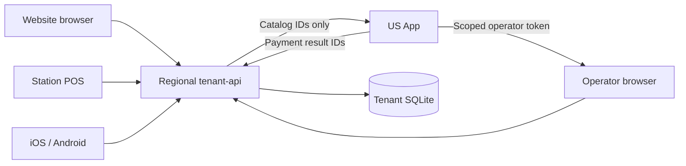
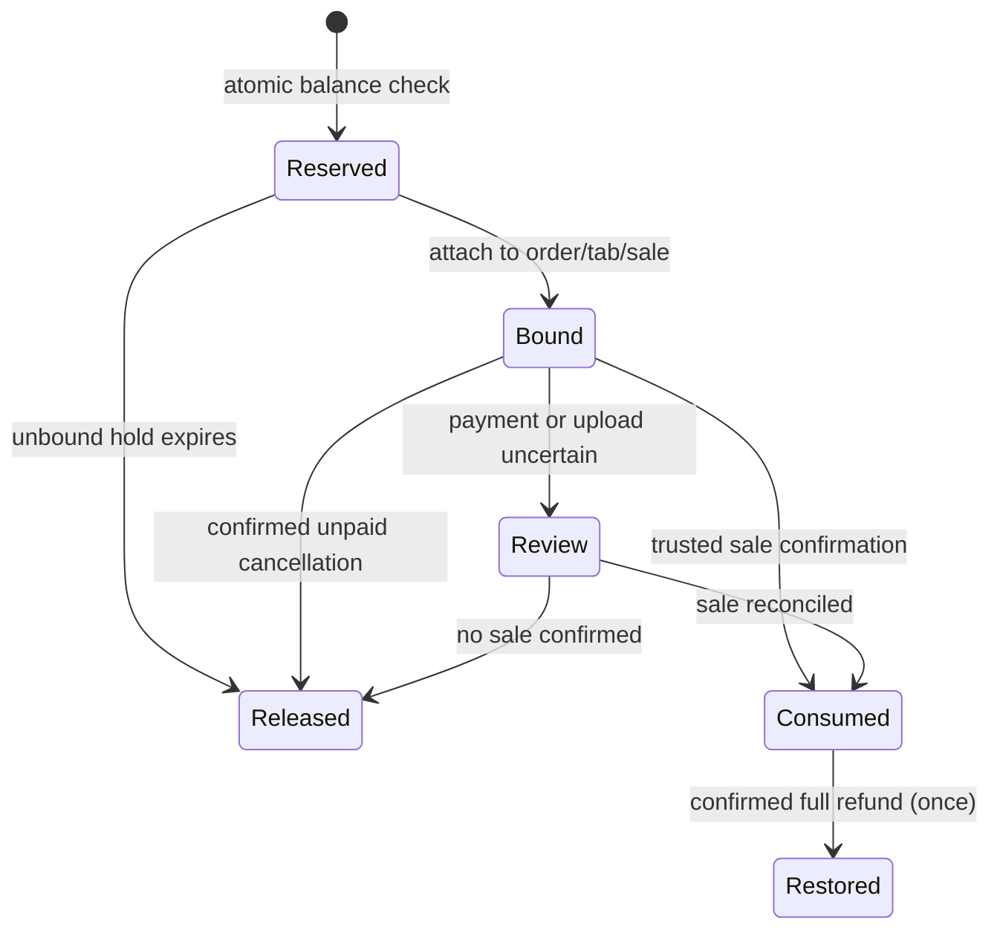

# Loyalty Rewards

The loyalty module: one points program per organization, shared by its
locations, earnable and spendable on the website, at the Station register, and
in the customer app (`apps/customer`). A customer is the member: there is no
separate member space, enrollment step or member list. Operators work from
Customers. This document is the canonical operator and engineering reference:
architecture, rules, runbooks, and the acceptance examples the math is tested
against.

Status: built behind flags (default off) and not yet enabled for any
organization. What each surface has today is in
[Status by surface](#status-by-surface). Deployment, the pilot, and rollback are
in [Migrations and deployment order](#migrations-and-deployment-order) and
[Pilot and rollback runbook](#pilot-and-rollback-runbook).

## Status by surface

| Surface                                                                                                 | State                                                                                             |
| ------------------------------------------------------------------------------------------------------- | ------------------------------------------------------------------------------------------------- |
| Regional API: programs, rewards, accounts, ledger, redemptions, reconciliation, tick, erasure           | Built                                                                                             |
| Website orders: reward at placement, earning, refunds                                                   | Built: the region and the Sites checkout reward picker                                            |
| QR tabs: one purchase per tab, reward on phone payment, counter close                                   | Built: the region, the App, and the Sites tab payment picker                                      |
| Operator App: Loyalty pages, Loyalty panel on the Customer profile, order refunds, counter close option | Built                                                                                             |
| Sites wallet                                                                                            | Built (balance, next reward, rewards, history, terms, member code, approvals)                     |
| Station till                                                                                            | Regional `/pos/loyalty/*` routes and the till sale adapter built; the Station screens are not yet |
| Customer app wallet (Expo, iOS and Android)                                                             | Built (balance, next reward, rewards, history, terms, member code, approvals, website link)       |
| Marketing audience filters                                                                              | Not built yet (no flag; it will be added with them)                                               |

Keep `loyalty.enabled` off for every organization until each channel it sells
through is built and has passed its launch checks.

## Scope and rules

- One program and one balance per organization. Locations share both.
- One earning method is active at a time; switching methods never resets
  balances. Methods: **spend** (points per spend unit), **visits** (points per
  qualifying purchase, once per organization-local calendar day), **items**
  (points per unit of selected items), **categories** (points per unit in
  selected categories; overlapping categories never double-count a line).
- Items and categories are picked by name from the published menus in the
  program and reward editors; the program stores their ids. A category counts
  the items it lists directly: choosing a parent category does not include the
  items of its subcategories, so choose those too.
- Points are integers; "points" vs "stars" is a display label
  (`program.unitLabel`), not a second currency.
- Every customer with a verified phone account is a member: signing up or in
  opens their points account automatically (see
  [Automatic enrollment](#automatic-enrollment)). Earning needs that verified
  customer account and an active points account. A POS phone contact never
  auto-links.
- The program terms (`terms` in the program config) are display text, shown in
  the wallet. They are not a gate: there is no terms version and no acceptance
  step, and editing the terms never stops anyone earning, spending or claiming.
  Loyalty never sets marketing consent; that stays a separate record.
- Only paid, completed purchases earn. Website: paid and completed. QR tabs:
  settled. Station: accepted, closed sales after sync, net of refunds. Unpaid,
  cancelled, held, or under-review sales earn nothing.
- Spend eligibility is merchandise value after discounts, excluding tax, tips,
  delivery fees and other non-merchandise charges, for both tax-inclusive and
  tax-exclusive menus. Fully discounted lines earn no item/category points.
- A configurable minimum qualifying merchandise spend gates earning.
- The program is locked to one currency (set at creation); orders in another
  currency are refused with `currency_mismatch`.
- Rewards: fixed or percentage discounts on the whole sale, selected categories,
  or selected items (percentage in basis points with an optional maximum), or
  one free configured item (one unit; the customer picks an available variant;
  paid modifiers stay chargeable). Discounts are capped at the eligible
  merchandise value; zero-value and inapplicable rewards are rejected without
  spending points.
- One reward per order or QR tab. Loyalty never stacks with other discretionary
  discounts (`stacking_not_allowed`).
- No tiers, referrals, transfers, expiry, or historical backfill at launch.
  Customers who verified before the program went live earn from their first
  order after it, not for earlier ones.
- Program and reward edits create new immutable versions; purchases snapshot the
  applied version and catalog facts, so later edits never change past awards.

## Automatic enrollment

A customer is the member. Loyalty keeps one points account per customer (the
`loyalty_members` row the ledger hangs off) and opens it without being asked:

- **At sign-in.** When a customer signs up or signs in with the phone OTP on
  Sites or in the customer app, tenant-api opens their points account right
  after the code verifies. This is fire-and-forget: a failure never fails the
  sign-in, and it only runs while the loyalty features are on for the
  organization and the node.
- **Lazily.** The account is also opened the first time anything customer-facing
  needs it: the wallet read, a checkout or tab quote, an order or tab claim, or
  a member code. So customers who verified before the program went live earn
  from their first order.
- **Verified phones only.** Only verified-phone customer accounts are linked. A
  POS-only phone contact is never auto-linked.
- **Never recreated.** A suspended or erased account is never recreated or
  reactivated by sign-in or by any customer call.
- There is no enroll endpoint, no enrollment screen and no `already_enrolled`.
  Operators do not enroll anyone either; they find the person in Customers.

Product decision for the operator to know: signing in joins the program. The
program terms are shown in the wallet but are not accepted explicitly, and there
is no opt-out or opt-in switch. An organization that needs explicit opt-in
consent is not supported in this release. Loyalty never sets marketing consent
(see [Privacy and erasure](#privacy-and-erasure)).

## Architecture and data residency

- All loyalty data (program, rewards, points accounts, balances, the append-only
  ledger, purchase snapshots, redemptions, approvals, codes, outbox) lives in
  the organization's **regional tenant SQLite** (`packages/tenant-db`, migration
  `0025_loyalty`). Nothing account-related is stored in, loaded by, or proxied
  through the US control plane, App loaders, or Sites SSR.
- The **US App** holds only feature flags (`ConfigFlag`), RBAC permissions, and
  mints short-lived scoped operator tokens (`lty+jwt`). Operator browsers call
  the regional `/operator/loyalty/*` routes directly with those tokens. Regions
  read an organization's flags from `GET /resources/loyalty/context` (internal
  token; flags only).
- Customers authenticate with their existing regional customer token (website
  `localStorage`, native Keychain/Keystore). The organization is resolved from
  the browser `Origin` plus a slug/host hint, never from a client-sent id.
- Pure contracts and math live in `@repo/loyalty` (`packages/loyalty`): Zod
  schemas for every route, earning/discount math, the token contract,
  permissions, error codes, and the frozen acceptance examples. No I/O.
  Restaurant catalog adaptation (orders, tabs, menus) lives in
  `apps/tenant-api/src/restaurant/`, outside the generic points accounting.
- Every write goes through `withLoyaltyWrite`
  (`apps/tenant-api/src/lib/loyalty-write.ts`): per-org exclusive lock, SQLite
  busy retry, real transaction, durable idempotency keys with request hashes.

## Flags, permissions, and the kill switch

Org flags (`ConfigFlag`, seeded system-false by control-plane migration
`0030_loyalty`). There is no marketing flag: the audience filters are not built,
and their flag will be added together with them.

| Flag                 | Gates                                                     |
| -------------------- | --------------------------------------------------------- |
| `loyalty.enabled`    | Everything: accounts, wallets, earning, operator screens. |
| `loyalty.redemption` | Spending points: quotes, holds, member codes, approvals.  |

Child flags read off while the master is off. Regions cache flags for 5 minutes.
While the App cannot be read, a cached **on** answer keeps serving for up to 15
minutes and a cached **off** answer for up to 24 hours; refreshes are
single-flight per organization, the App call times out at 2 seconds, and a
failed refresh is not retried for 30 seconds. With no usable cache the state is
unknown: order placement still records loyalty (a paid sale is never refused
because a flag read failed), but quotes, holds, approvals, member codes and the
customer and till routes answer 503 `loyalty_unavailable` until the App answers
again (`apps/tenant-api/src/lib/loyalty-context.ts`).

Permissions (seeded by the same migration; only `org_role_admin` receives them;
member and viewer roles get none). A custom role can be granted any of the five
in the role editor, where the Loyalty group appears while the organization's
`loyalty.enabled` is on:

| Permission                      | Allows                                                                     | Scope       |
| ------------------------------- | -------------------------------------------------------------------------- | ----------- |
| `read:loyalty:any`              | The Customer profile's Loyalty panel, activity, program/reward views.      | `read`      |
| `update:loyalty_program:any`    | Program and reward editor.                                                 | `setup`     |
| `update:loyalty_points:any`     | Manual point adjustments and suspend/resume (reason + audit required).     | `members`   |
| `update:loyalty_redemption:any` | Review queue decisions, QR tab refunds, requeue, balance check and repair. | `reconcile` |
| `read:loyalty_report:any`       | Loyalty reports.                                                           | `reports`   |

Every `update:*` implies `read:loyalty:any`. Operator tokens are HS256
`lty+jwt`, audience `tenant-api-loyalty-operator`, 15-minute TTL (5 minutes when
impersonating or holding a points/redemption grant), grants intersected with the
requested scope, impersonation never carries write grants, and the `region`
claim must match the node. Mint: `GET /<orgSlug>/loyalty/token?scope=` (App).
The operator's `locationScope` becomes the token's `locationIds`;
location-scoped operators never see other locations' account history. An account
(the Loyalty panel's lookup by customer and its detail) is visible only when it
has a purchase or redemption at one of their locations (or an organization-wide
one), or a ledger entry tied to one; everyone else's answers 404
`member_not_found`. Reports honor the scope too: a scoped token's figures count
only its locations (organization-wide rows, and accounts with a purchase there,
included). Balance adjustments, account status changes and the balance check and
repair are organization-wide, so a location-scoped token gets 403
`location_forbidden` on them.

Recording a refund on an order is an Orders action: it needs menu edit rights
(`update:menu:any`, the `orders:write` token) and works whatever the loyalty
flags say. When loyalty tracks the order (a purchase, or a redemption that was
not released), the refund takes points back and may restore a reward, so it also
needs `update:loyalty_redemption:any`: the App signs `refundLoyalty` on the
orders token only for holders, never while impersonating, and the region answers
403 `loyalty_refund_forbidden` (or `impersonation_forbidden`) otherwise. The
orders token also carries the operator's `locationIds`; orders at other
locations are left out of the list and answer 404.

**Regional kill switch**: `LOYALTY_ENABLED=false` (also `0`, `off`, `no`,
`disabled`) on a tenant-api node stops new loyalty work on that node. Customer
and till writes answer 503 `loyalty_unavailable` (member codes, till
identification, quotes, holds, approvals), no account is opened (sign-in joins
nothing while the switch is on), new orders neither earn nor take a reward, and
operator writes that start something new (program and reward edits, point
adjustments, account status) answer 503 too. The reads a site renders from stay
quiet instead of erroring: `GET /loyalty/program` and `GET /loyalty/wallet`
answer 200 with a `null` program and wallet, so the surface simply hides
loyalty. Work that already started keeps going: the tick, reconciliation of
claimed purchases and bound redemptions, review decisions, QR tab refunds,
requeue, and balance repair. A till can still read and cancel its own approvals
and forget a member (`GET /pos/loyalty/approvals/:id`,
`POST /pos/loyalty/approvals/:id/cancel`, `POST /pos/loyalty/member/revoke`; the
device secret, and a staff session where the terminal requires sign-in, are
still needed), also while the organization flag is off. Operators can still read
the program, rewards, accounts, activity, and reports. The switch lives in
`apps/tenant-api/src/lib/loyalty-switches.ts` (read live on every request).

The kill switch, not an organization flag, is the emergency stop: a region may
keep serving a cached `loyalty.enabled` on for up to 15 minutes after the flag
is turned off, while `LOYALTY_ENABLED=false` applies to the very next request.

### When loyalty is off

|                                                                                 | `loyalty.enabled` off for the organization                                    | `LOYALTY_ENABLED=false` on the node                                                 |
| ------------------------------------------------------------------------------- | ----------------------------------------------------------------------------- | ----------------------------------------------------------------------------------- |
| Opening accounts, codes, quotes, holds, approvals, earning on new sales         | Stopped                                                                       | Stopped                                                                             |
| Tick and reconciliation of work already started                                 | Keep running                                                                  | Keep running                                                                        |
| Points back after **Record a refund** on an order                               | Automatic                                                                     | Automatic                                                                           |
| App Loyalty pages: review queue, QR tab refunds, repair, Customer Loyalty panel | Hidden (the App answers 404 and mints no token): this work waits for the flag | Available: reads, review decisions, QR tab refunds, repair; other writes answer 503 |

The tradeoff of the flag: while it is off, the review queue waits, and a QR tab
refunded in the payment dashboard keeps its points until someone records the
refund after the flag is back on (the member may then go into points debt).
Order refunds have no such gap.

## Earning

Earning runs from the purchase snapshot (`loyalty_purchases`), which freezes
currency, per-line net merchandise, tax basis, the applied loyalty discount
allocation, and the program version. The earning engine
(`@repo/loyalty/src/earning.ts`) is pure and tested against the frozen
acceptance examples (quoted below). Rounding: spend rounds down once per order,
never per line. One purchase can never earn more than one ledger entry holds
(`LOYALTY_MAX_POINTS`, 100,000,000): a spend rule whose points outrun its spend
unit is refused when the program is saved, and the cap is an overflow guard for
the rules the program accepts, never a way to earn more than one entry holds.
Visits use the organization's local calendar day and earn at most once per day
per member. Points post to the append-only `loyalty_ledger`; `loyalty_balances`
is a transactional projection rebuildable from the ledger
(`GET /operator/loyalty/balances/check`,
`POST /operator/loyalty/balances/:memberId/repair`).

A purchase earns once per source:

- **Website orders** (`restaurant_order`): a signed-in active member claims the
  order at placement; it earns once it is paid and completed. A QR tab round is
  never its own purchase.
- **QR tabs** (`qr_tab`): one purchase however many rounds and payments it had.
  The first signed-in member to order a round or pay from the phone claims it;
  another member cannot then spend a reward on it (`already_claimed`). It earns
  when the tab settles. A reward applies to a tab only when the tab is paid from
  the phone (`POST /loyalty/tab/quote` prices the rewards,
  `POST /orders/tab/pay` binds one); closing at the counter gives a held reward
  back. When the counter close is marked **Rung up on a Station till**
  (`rungUpOnStation`, shown while loyalty is on), the tab earns nothing
  (`rung_up_on_station`) and the till sale earns instead. Marked by mistake?
  **Remove the mark** on Orders (listed for 24 hours after the close,
  `GET /operator/qr/tabs?status=station`) calls
  `POST /operator/qr/tabs/:id/clear-station-flag`, which unmarks the closed
  counter tab; the exclusion reopens so the tab earns after all.
- **Station sales** (`pos_order`): accepted, closed sales after sync, through
  the till sale adapter (`posOrderLoyaltySource` in
  `apps/tenant-api/src/restaurant/pos-loyalty-source.ts`). The Station screens
  that identify a member and redeem are not built yet.

## Redemption

- Quotes are non-binding and always computed region-side from priced carts,
  never client prices. The website quotes at `POST /loyalty/checkout/quote`, a
  QR tab at `POST /loyalty/tab/quote`, the till at `POST /pos/loyalty/quote`.
- Reserving is atomic inside the order's transaction: concurrent website,
  native, and POS requests cannot reserve the same points. An unbound hold lasts
  15 minutes. A hold bound to an unpaid online order also outlives the order's
  own hold while its payment page can still take the discounted total: 46
  minutes past the hold for a Stripe Checkout session (connect), 24 hours 15
  minutes for a Checkout.com page (`ONLINE_PAYABLE_AFTER_HOLD_MS` in
  `apps/tenant-api/src/restaurant/loyalty-sources.ts`). A payment that lands in
  that window goes to the review queue with the reward still attached, instead
  of the guest keeping both the discount and the points.
- Binding ties the hold to one member, cart hash, source id, currency, reward
  version, and discount allocation. The website binds before the payment session
  exists, so the provider always charges the discounted total.
- A timeout never releases a bound redemption: cancellation or payment expiry
  confirmed by the order/tab state does (`order_cancelled`, `payment_expired`,
  `tab_voided`, `counter_close`, `order_refunded`). Uncertain money or uploads
  (paid then cancelled without a full refund, payment review, a till sale that
  never uploaded) go to the review queue for an operator with
  `update:loyalty_redemption:any`.
- POS spending needs consent: the member code only _identifies_; the customer
  approves in their signed-in wallet (`/loyalty/approvals`) or by the regional
  OTP flow sent to the verified phone. The uploaded sale is then re-checked
  against the approval: not only the discount amount, but the reward re-priced
  on the uploaded lines (item, quantity and price per line). A sale whose lines
  no longer earn the approved discount waits in review as `upload_mismatch`. The
  approval also binds the terminal: a sale id belongs to the terminal that made
  it (a second terminal cannot request an approval for it or spend a reward
  approved elsewhere), and a reward whose upload arrives from another terminal
  waits in review as `device_mismatch` with the points still held. Only the
  sale's own terminal can stall it with an unreadable newer revision
  (`upload_held`): a held upload that names the sale from a different terminal
  is ignored.

## Refunds

No provider refund or chargeback reaches the region, the region never calls a
payment provider, and cancellation alone is not refund evidence. The App's
Stripe and Checkout.com webhooks pass refund and dispute events (`refund.*`,
`charge.dispute.*` and their Checkout.com equivalents) to reservations only;
restaurant orders and QR tab payments receive their payment events and nothing
else. So recording is a **manual step**: an operator records every refund made
in a provider dashboard, and every chargeback the organization loses (the
disputed amount, once the dispute is lost; a won dispute needs nothing). That
audited record is the evidence, and until it exists the member keeps the points
earned on that money:

- **Online orders**: Orders, open the order, **Record a refund**: everything
  that is left, or an amount, with a note (3 to 280 characters). It shows on
  paid online orders that are not QR tab rounds, also once they are completed or
  cancelled, for members who can edit the menu. An order that earned or spent
  points also needs `update:loyalty_redemption:any` and a session that is not
  impersonating (403 `loyalty_refund_forbidden` / `impersonation_forbidden`),
  and a location-scoped member reaches only their locations' orders. The order
  then reads **Refunded** or **Partly refunded** (the payment status stays
  `paid`), and its activity lists each refund with its note. Behind it:
  `POST /operator/orders/:id/refunds` (`Idempotency-Key` required; 422
  `refund_exceeds_payment` with `refundableCents`; 409 `refund_complete`,
  `refund_not_online`, `refund_not_paid`, `idempotency_conflict`), the
  append-only `restaurant_order_refunds` table, and
  `restaurant_orders.refunded_cents`, which can only grow and never passes the
  order total (tenant-db `0025_loyalty`). Loyalty reads the order's refunded
  total every time it reconciles the order, so the points come back whatever the
  loyalty flags or the kill switch say. A paid order that was cancelled waits in
  the review queue until its full refund is recorded, which releases its reward
  on its own.
- **QR tabs**: Customers, the customer, the Loyalty panel, the tab's purchase,
  **Record refund** (`POST /operator/loyalty/refunds`, source `qr_tab`; needs
  `update:loyalty_redemption:any`). Only a tab paid from the guest's phone can
  be refunded here (`refund_not_online` / `refund_not_paid`): counter money
  moved outside the providers, so there is no refund to mirror. This needs the
  Loyalty panel, so it waits while `loyalty.enabled` is off (see
  [When loyalty is off](#when-loyalty-is-off)).
- **Station sales**: the till's own append-only refunds, uploaded with the sale.
  The till sale adapter reads the sale's refunded total each time it reconciles
  the sale, so nothing is recorded by hand.

Reversals use the original earning snapshot and the cumulative refunded amount,
idempotently:

- Partial refunds reverse proportionally per the snapshot; the reversal may
  drive the available balance negative (points debt), which blocks further
  redemption until earning or adjustment covers it.
- A confirmed **full** refund restores a consumed reward's points once. Partial
  refunds never restore reward cost.
- Amount-only refunds allocate deterministically (largest remainder over the
  snapshot lines) and keep their calculation snapshot.

## Surfaces

### Regional API (`apps/tenant-api`)

- Customer `/loyalty/*`: `GET /program` (anonymous), `GET /wallet`,
  `GET /history`, `POST /member-code`, `GET /approvals`,
  `POST /approvals/:approvalId/decide`, `POST /checkout/quote`,
  `POST /tab/quote` (with `X-Tab-Token`; answers 503 `dine_in_unavailable` while
  `QR_DINE_IN_ENABLED=false`). Mutations take `Idempotency-Key`; all responses
  are `private, no-store`. Each address gets at most 240 reads and 120 writes a
  minute (429 `rate_limit_exceeded`), on top of the durable per-customer limits
  on quotes, member codes and approval decisions. There is no enroll route:
  `GET /wallet` opens the account itself (see
  [Automatic enrollment](#automatic-enrollment)) and answers
  `member: { id, status }` with `status` `active` or `suspended`; `member` is
  `null` only when the program is unavailable or the account is erased, and the
  wallet is `null` while the program is unavailable. Quotes, member codes and
  claims open a missing account the same way, never a suspended or erased one.
- Operator `/operator/loyalty/*`: program and reward CRUD with `expectedVersion`
  optimistic concurrency, accounts (by customer, detail, adjust, suspend and
  resume; there is no list and no search: Customers is how an operator finds a
  person), activity feed, review queue and decisions (`/review`,
  `/redemptions/:id/resolve`, `/purchases/:id/resolve`), QR tab refunds
  (`/refunds`), `/requeue`, balance check/repair, `/reports`. Guarded per route
  by scope + grant; reconcile routes skip the flag and kill-switch gates and
  reads skip the kill switch, by design.
- POS `/pos/loyalty/*`: identify by member code, binding read/revoke, quotes,
  approval request/poll/cancel, OTP send/verify. Device secret auth (+ staff
  session when the terminal requires sign-in). Rate-limited per device, per
  approval, and per member. The loyalty block of a till sale upload is parsed
  field by field (`posOrderLoyaltySchema` in `@repo/common/pos-orders`): a
  malformed field is dropped, never a reason to reject the paid sale.
- Website order placement (`POST /orders`) accepts an optional `loyalty`
  selection (`{ rewardId, rewardVersion, expectedDiscountMinor, targetLineId }`,
  `@repo/common/order-loyalty`): the reward is re-quoted server-side and bound
  in the placement transaction; the stored order carries `loyaltyDiscountCents`
  and the discounted tax/total. Tab payment (`POST /orders/tab/pay`) does the
  same for QR tabs. A changed reward, balance, or cart is refused, never applied
  silently.
- Orders: `POST /operator/orders/:id/refunds` (above); operator order reads
  carry `refundedCents`, and `GET /operator/orders/:id` lists `refunds`.
- Tick: `POST /api/loyalty/tick` (`INTERNAL_COMMAND_TOKEN`).

### Operator App

Loyalty section (Overview, Program, Rewards, Activity) under the org nav,
visible per flags + grants (`requireLoyaltyAccess` answers 404 while
`loyalty.enabled` is off). There is no Members page. The browser talks
browser-direct to the region with scoped tokens; App loaders never see customer
loyalty data.

- **Overview**: a setup preview (worked earning and redemption examples from the
  actual config) and, with the report grant, the report, including how many
  items wait for review.
- **Program** and **Rewards**: the editors, with catalog pickers for items,
  categories, and the free item. The program's terms are a display text field.
  Money fields accept ASCII and Arabic-Indic digits and the Arabic decimal and
  thousands marks; a comma only ever groups thousands, never a decimal mark, and
  percent fields take digits with one dot (`apps/app/app/utils/money-input.ts`).
- **Activity**: the point feed (each row links to the customer) and, with the
  redemption grant, the review queue.
- **Customer profile, Loyalty panel** (Customers, open a customer): shown when
  `loyalty.enabled` is on and the user has `read:loyalty:any`. It shows points
  available, reserved and lifetime, the account status, and recent history; with
  the grants it adjusts points and suspends or resumes the account, and a QR tab
  purchase offers **Record refund**. A purchase from a website order links to
  the order (with order access). To find a person, search Customers.

Outside the Loyalty section: **Record a refund** on Orders, and the **Rung up on
a Station till** option when closing a QR tab at the counter, with **Remove the
mark** on Orders for a mistaken one (listed for 24 hours after the close).

### Website and native

Sites (built): the wallet page (balance, next-reward progress, rewards, history,
the program terms as text, member code, approvals; no sign-up step, the account
opens at sign-in) and the checkout and tab reward pickers that quote and refresh
totals from the region, all browser-direct with the customer token, never
through Sites SSR. Placing an order or a tab payment never waits on loyalty
without a pick; with one it waits at most 8 seconds for the pick's quote, then
asks the guest to try again or go on without the reward, so a region that is
down never holds checkout. Customer app (`apps/customer`, built): the same
wallet (balance, next-reward progress, rewards, history, terms as text, a
plain-text member code, POS approvals) and a token-free link to order on the
website. The API client and store are in `lib/loyalty/`, the screens in
`components/loyalty/`; its tests decode `packages/loyalty/contract-fixtures` in
place. No in-app cart/checkout.

## Privacy and erasure

Person erasure (`POST /operator/customers/:customerId/erase`, see
[Erasing a person](tenant-data-residency.md#erasing-a-person)) closes the
person's points account in the same regional transaction
(`apps/tenant-api/src/services/loyalty-erasure.ts`): codes and till bindings are
deleted, pending approvals cancelled and unbound holds released, the account row
is marked `erased` and unlinked from the customer (a trigger keeps it closed),
ledger and loyalty refund notes are cleared, and the account's audit rows are
redacted. Balances, ledger entries, purchases and redemptions stay as the
anonymous financial trail. Erasure also clears the notes of the customer's order
refunds (the amounts stay). Retried POS uploads cannot recreate an erased
account (claims of a missing account fail closed), and neither can sign-in or
any customer call: an erased (or suspended) account is never recreated. Opening
an account never sets marketing consent, and nothing in loyalty does; the
planned marketing filters (not built yet) only narrow the existing regional
campaign audience, which rechecks consent and suppression at send time.

## Operations

- **Tick**: `POST /api/loyalty/tick` per node. Drivers: the hourly jobs-cron
  fan-out (`Tenant loyalty tick`), a Durable Object alarm module on the US
  Workers node (re-armed about every 2 minutes while something is due), and an
  in-process interval on Node (OCI) nodes (`LOYALTY_TICK_INTERVAL_SECONDS`,
  default 120, minimum 60, `0` off). Every task is idempotent, so the drivers
  may overlap. The tick releases expired unbound holds, expires pending till
  approvals, queues a till redemption whose sale arrived or sends it to review
  when the sale has not uploaded a day later (never released by a timer),
  retries the loyalty outbox with backoff (parked after 12 attempts for an
  operator), and purges what nobody can use any more: codes, bindings, closed
  till requests (approved ones stay as the record of consent) and finished
  outbox rows after 30 days, expired idempotency records, and old rate counters.
  It ignores the flags and the kill switch: everything it does finishes work
  that already started. Organizations without a program are skipped.
- **Parked sources**: parking sends the source's open purchase and bound
  redemption to the review queue. The hourly cron run fails when its own tick
  parks a source (`outboxParked` in the tick's counts; the alarm and interval
  ticks log it at error level); after that, jobs-cron logs the standing total
  (`outboxParkedTotal`) as a warning on every run instead of failing, so one
  undecided item never hides new failures. A parked source stops counting once
  an operator has decided every review item on it, or when it is queued again (a
  later sale change, or **Try again**). A parked source with nothing in review
  (a refund that keeps failing on a completed sale, or a sale whose only hold
  ended after it parked) is listed in the review queue as **Not updated**, with
  its error code. **Try again** (`POST /operator/loyalty/requeue`,
  `update:loyalty_redemption:any`) queues it once more, or clears it when
  nothing is left to reconcile; if the cause is not fixed, it parks again after
  12 more attempts.
- **Missing till uploads**: a till redemption whose sale has not arrived a day
  later goes to the review queue (`upload_missing`). The hourly cron run fails
  when its own tick sends one there (`uploadsMissing`); while any is still
  waiting for an operator to consume or release it, jobs-cron logs the standing
  total (`uploadsMissingTotal`) as a warning.
- **Reconciliation**: order, QR, and POS state changes queue the source; the
  outbox re-reads the authoritative row every attempt, so late, duplicate, or
  out-of-order events converge. A paid sale is never altered or rejected because
  loyalty is unresolved: uncertainty goes to the review queue.
- **Review queue** (Loyalty, Activity): consume or release a redemption, award
  or exclude a purchase, each with a note. Only an operator resolves an item (or
  the sale settling on its own, such as a full refund recorded on a cancelled
  order), and the queue waits while `loyalty.enabled` is off. A till sale that
  would push a member past 1,000 register-earned points in one
  organization-local day lands here as `large_earn` instead of earning, until an
  operator awards it; website and QR-tab earning are unaffected.
- Manual adjustments move at most ±1,000,000 points per call, and one operator
  can add at most 1,000,000 points in any 24 hours (`adjustment_limit`, 429).
  Removing points has no daily limit, so a mistaken removal can be undone the
  same day. The service enforces both limits, and every adjustment is audited.
  There is no second-person approval: only roles with
  `update:loyalty_points:any` can adjust (by default only the built-in admin
  role), and the limit is a flat number of points, not scaled to what a point is
  worth.
- **Monitoring**: `GET /operator/loyalty/balances/check` diffs stored balances
  against ledger rebuilds; the report's operations block counts review items,
  outbox backlog, and reservation age.

Environment (tenant-api only): `LOYALTY_ENABLED` (kill switch, unset means on)
and `LOYALTY_TICK_INTERVAL_SECONDS` (Node runtime, default 120, minimum 60, `0`
off). Both are documented in `apps/tenant-api/.env.schema` and `.env.example`.

## Migrations and deployment order

| Plane                     | Migration      | Contents                                                                                                                                                                                                                                                                                                                                                                                                                                                                                 |
| ------------------------- | -------------- | ---------------------------------------------------------------------------------------------------------------------------------------------------------------------------------------------------------------------------------------------------------------------------------------------------------------------------------------------------------------------------------------------------------------------------------------------------------------------------------------- |
| Control plane (D1/LibSQL) | `0030_loyalty` | Five loyalty permissions granted to `org_role_admin` only, and the two `loyalty.*` flags (`loyalty.enabled`, `loyalty.redemption`) as system-level `false`.                                                                                                                                                                                                                                                                                                                              |
| Tenant SQLite             | `0025_loyalty` | The `loyalty_*` tables (including the outbox and its lease column; `loyalty_members` carries `created_at` and no enrolled channel or terms fields, and program versions carry no terms version), unique source and event keys, the append-only `restaurant_order_refunds` table, `restaurant_orders.loyalty_discount_cents` and `refunded_cents`, `qr_tabs.loyalty_discount_cents` and `rung_up_on_station`, and every append-only, state-transition and refund-total trigger and index. |

Both are additive, and each plane has exactly one migration for this release.
Tenant migrations ship with tenant-api: Node nodes apply them when they open an
organization's database, and the US Worker bundles them into the Durable Object
(`npm run deploy:cf` regenerates `workers/migrations.generated.ts` with
`scripts/generate-do-migrations.mjs`).

Deploy order for the first release: migrate the control plane, deploy tenant-api
on both nodes, then deploy App, Admin, Sites and jobs-cron. The flags stay off
until the pilot, so nothing a customer or an operator can see changes.

CI does not run these as separate steps. `deploy.yml` applies the control-plane
migration first, then triggers the App, Admin, Sites, jobs-cron and US
tenant-api builds together, and the KSA OCI deploy finishes later. The only real
ordering constraint is that the App's **Record a refund** calls a tenant-api
route (`POST /operator/orders/:id/refunds`). Until a node has deployed, that
call can answer 404 on that node, and the hourly `Tenant loyalty tick` can fail
there. Both heal themselves once the node is up: record the refund again, and
the next tick runs. Regions read the loyalty flags from the App and fail closed
(see above), so the flag path is safe in any order. Until the App serves
`/resources/loyalty/context`, loyalty is `unknown` in a region, not off: nothing
new starts (opening accounts, codes, quotes, holds and spending refuse), but
sales of signed-in customers are still credited (`loyaltyCreditsSales` in
`apps/tenant-api/src/lib/loyalty-context.ts`).

What each deploy carries:

- Control plane: permissions and system-false flags.
- Regional tenant-api, both nodes: loyalty routes, the tick, order and tab
  wiring, and order refunds.
- App and Admin: permissions, token mint, `/resources/loyalty/context`, nav,
  Loyalty pages, the Customer profile's Loyalty panel, order refunds, the
  counter close option.
- jobs-cron: the hourly `Tenant loyalty tick` (the alarms and intervals run
  without it).
- Sites and the customer app read the flag live (the wallet and pickers);
  Station follows when its screens are built.

## Pilot and rollback runbook

Pilot:

1. Pick pilot organizations whose channels are all built, and tell them that
   signing in joins the program (see
   [Automatic enrollment](#automatic-enrollment)). Grant the loyalty permissions
   to the roles that need them (only `org_role_admin` has them).
2. Set `loyalty.enabled` for the pilot organizations only. Create the program
   and rewards in draft, check the setup preview, then activate it. Regions pick
   the flag up within the 5-minute cache.
3. Watch for a few days: the review queue, the report's operations block, and
   `GET /operator/loyalty/balances/check` (no differences expected). Compare the
   refunds and disputes in each pilot organization's payment dashboard with the
   refunds recorded in Orders and Loyalty: none is recorded on its own.
4. Then set `loyalty.redemption` the same way. The marketing filters are not
   built; their flag will be added with them.

Rollback:

- One organization: turn its flags off (`loyalty.redemption` first to stop
  spending only). New operations stop; the tick and reconciliation keep settling
  what already started; order refunds keep taking points back. The review queue
  and QR tab refunds wait until the flag is back on.
- One node, immediately: set `LOYALTY_ENABLED=false` on the tenant-api node (see
  the kill switch above). Operators keep reads, review decisions, QR tab
  refunds, and repair.
- Code: before any organization enables loyalty, reverting the whole release is
  safe; the tables and routes are inert. Once any organization has loyalty data,
  never drop the tables: the ledger, purchases, redemptions, and refunds are
  never deleted. After the pilot, first set `LOYALTY_ENABLED=false` on both
  tenant-api nodes, then roll back App code. Never roll back tenant-api code
  once any organization has had a loyalty flag on: older code no longer settles,
  reverses or restores the purchases and redemptions already open, and customers
  would keep or lose points with no record. Fix forward with the kill switch on
  instead.

## Acceptance examples

Frozen in `packages/loyalty/src/acceptance-examples.ts` (changing one is a
product decision) and verified by `acceptance-examples.test.ts`.

**Earning**

- `spend-excludes-tax-tip-fees`: 1 point per
  $1 of merchandise after
  discounts; tax, tip and delivery fee earn nothing. $16.75
  merchandise of a $24.24 payment earns 16.
- `spend-rounds-once-per-order`: 10 points per $3: $10.00 earns 33, not 16 + 16
  per line.
- `visit-below-minimum`: a visit needs the minimum qualifying spend
  ($5.00):
  $4.99 earns nothing (`below_minimum`).
- `visit-once-per-local-day`: the second qualifying purchase on the same local
  day earns no visit (`visit_already_awarded`).
- `items-per-unit`: 5 points per latte: two lattes and a muffin earn 10.
- `categories-never-double-count`: a latte in both selected categories counts
  once: 2 units × 3 = 6.
- `free-reward-unit-earns-nothing`: the unit a free-item reward gave away earns
  no item points, even with a paid modifier; the paid latte earns 5.
- `fully-discounted-line-earns-nothing`: a line discounted to zero earns no item
  points (`nothing_eligible`).

**Discounts**

- `fixed-capped-at-eligible`: $5 off a $3.50 order takes $3.50 off, never more.
- `percent-with-maximum`: 20% off pastries, at most $3: $20 of pastries takes $3
  off.
- `percent-rounds-down`: 15% off a $2.99 bagel is 44 cents.
- `free-item-dearest-variant`: a free latte defaults to the dearest variant's
  base price; modifiers stay chargeable.
- `free-item-chosen-variant`: the customer may pick the small latte: $3.00 off;
  the 60-cent oat milk is still paid.
- `largest-remainder-allocation`: $1 off three $1 lines splits 34/33/33, the
  extra cent to the first line.
- `zero-value-rejected`: a free item whose base price is zero is refused; no
  points move.
- `not-applicable`, `no-stacking`, `currency-locked`: refusal codes
  `reward_not_applicable`, `stacking_not_allowed`, `currency_mismatch`.

**Refunds**

- `spend-partial-then-full`: $40 of merchandise paid $45: each $9 refund takes
  back 8 points; the final full refund takes the remaining 24.
- `visit-falls-below-minimum`: a visit with a
  $10 minimum is reversed when a
  refund leaves less than $10.
- `items-proportional`: three items at 5 points each: a $3 refund keeps 12 of 15
  points; a repeated event takes back 0 (idempotent).

End-to-end, through the regional routes:

- Order refunds (`apps/tenant-api/src/routes/operator-order-refunds.test.ts`): a
  $10.00 order refunded $2.50 and then the rest ends with two refunds (250 and
  750 cents) and `refundedCents` 1000; a replay with the same `Idempotency-Key`
  answers 200 with the first refund, and the same key with a different body
  answers 409. An order that earned 10 points keeps 7 after a $2.50 refund, even
  with `LOYALTY_ENABLED=false` on the node.
- QR tabs (`apps/tenant-api/src/routes/qr-tab-loyalty.test.ts`): paid from the
  phone, a tab spends its reward and earns once on what was paid; closed at the
  counter it gives the reward back and earns on the full tab; rung up on a
  Station till it earns nothing; a second member cannot spend a reward on a tab
  the first member claimed; nobody signed in, nobody earns.

## Known limitations

- Manual adjustments do not raise `lifetimeEarned` (earn/earn_reversal only).
- A full-refund reversal of a visit award does not free that day's visit slot
  (anti-abuse; deliberate).
- Loyalty discount tax recomputation uses the location's single tax rate over
  per-line taxable amounts, rounded once per order (the same rule the pricing
  engine already applies).
- A category counts only the items it lists directly, not those of its
  subcategories.
- While `loyalty.enabled` is off, the review queue and QR tab refund recording
  wait until it is back on.
- Customer order totals in people records and the customers report still count
  an order's full total: recorded refunds are not subtracted.
- Provider refunds and chargebacks of restaurant orders and QR tab payments are
  not mirrored from the Stripe or Checkout.com webhooks. Each one is recorded by
  hand (see [Refunds](#refunds)); until then the member keeps those points.
- Marketing loyalty filters are not built; their flag will be added with them.
  There is no loyalty campaign sender.
- Joining is automatic: signing in joins the program, and there is no opt-out or
  opt-in in this release. The terms are display text, not an acceptance step. An
  organization that needs explicit opt-in consent is not supported.
- Customers search is the only way to find a person's account; there is no
  loyalty member list or search.
- An unknown flag state (the App is unreachable and the cache is cold) lets an
  order record loyalty claims for an organization whose flag is off. This is
  deliberate: a paid sale is never refused.

## Behavior changes in this release

- POS upload review reasons now run every check, and "holding" reasons win. The
  precedence changed for all sales, not only loyalty ones; it is needed so that
  till-flag earns are not masked by another reason.
- A large manual till discount labeled `loyalty` is still flagged
  `large_discount` unless a redemption on that sale backs it.
- A full refund recorded before a QR tab's reward is consumed restores the
  reward when the reward is consumed.
